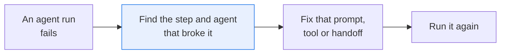
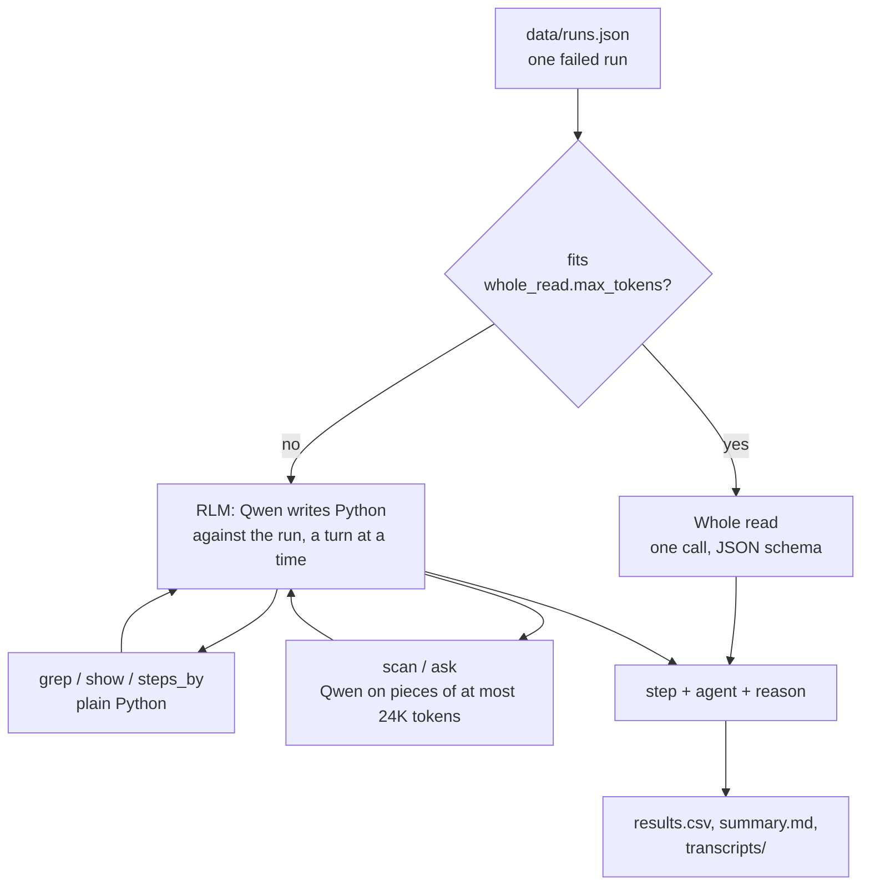

# Find the step that broke a failed agent run

> **This example:** a team that runs coding agents on a small made-up invoicing library, Ledgerline,
> and reads the trace of each failed run to find what to fix.
>
> **How it works:** Qwen on SIE reads a short run in one call. A run too long for one call goes to a
> recursive language model (RLM): Qwen writes Python against the run in a sandbox, a turn at a time,
> with helpers that search it and that ask Qwen about pieces of it, and names the step and the agent
> where the decisive error came in.
>
> **Use the same pattern for:** any long log you need a judgement about, such as a support thread
> with a customer, an incident timeline or a long chat with a tool-using assistant.

## Background

Teams that run AI agents in production read failed runs all day. A run is a trace: every message an
agent wrote, every handoff from one agent to another, and every command and its output, in order.
When a run fails, someone opens the trace and works out where it went wrong, so they fix the prompt,
tool or handoff that caused it.

That matters because the failure usually shows long after the cause. A test fails at step 400 because
of an instruction at step 20. Fix the step where it showed and the next run fails the same way.
Traces also get long: a coding agent that runs for an hour writes hundreds of thousands of tokens,
mostly command output.



## The problem

Reading a whole trace in one model call is the best option when it fits: the model sees every step
next to every other one. Two things get in the way:

- **Many traces don't fit.** An hour-long coding session can be hundreds of thousands of tokens, and a
  long-running agent's history can be millions. Cutting the middle out loses exactly the steps where
  the error usually came in.
- **The root isn't where the trace looks worst.** The loudest step is the failed test or the reviewer's
  verdict. The root is often a quiet instruction much earlier, which a later agent then carried out
  faithfully. So whatever reads the trace has to look back from the failure, not stop at it.

So the recipe reads a run whole when it fits, and otherwise lets the model navigate it: search it,
read the steps that matter, and ask questions about pieces it can't read at once.

### Examples

The runs are synthetic, written for this recipe by `make_data.py` under this repo's Apache 2.0
license. Ledgerline isn't a real project, and each run has one planted step where its decisive error
came in.

- **short-handoff** (21 steps, about 5,500 tokens). The task says interest is charged on an invoice's
  unpaid balance. At step 11 the coordinator tells the coder to charge it on `invoice.total`; the coder
  and the reviewer follow that instruction, and the acceptance check fails on a part-paid invoice. It
  should name step 11 and the coordinator, not the coder who wrote the code.
- **medium-off-by-one** (65 steps, about 36,000 tokens). The coordinator's instruction is right ("one
  day late is one month"). At step 30 the coder counts full months instead, so an invoice ten days late
  owes nothing. It should name step 30 and the coder.
- **long-swallowed-error** (491 steps, about 420,000 tokens, far more than one call can read). The task
  says a due date that can't be read must raise an error. Early on, a date-parsing test fails, and at
  step 22 the coder makes `late_interest` return zero whenever a due date doesn't parse, "so the suite is
  green". Hundreds of steps of other work follow before the acceptance check fails on an imported invoice
  whose date is written another way. It should name step 22 and the coder.

## How we'll solve it

1. **Measure the run.** Count its characters and divide by `chars_per_token` (3 for English and code).
   A run up to `whole_read.max_tokens` is read whole; a longer one goes to the RLM.
2. **Whole read.** One call with the task's definition of a root step and the whole run, and a JSON
   schema for the answer: the step, the agent and a sentence of evidence.
3. **RLM.** Qwen gets a Python sandbox holding the run, plus short summaries: the task the run was
   given, its last two steps and how many steps each agent wrote. Each turn Qwen writes a little code,
   the sandbox runs it and Qwen reads what it printed, for at most `rlm.max_turns` turns. It has helpers:
   - `grep`, `show` and `steps_by` read the run in plain Python and cost no model call;
   - `scan(question)` asks Qwen the same question about every piece of the run, in parallel, and
     returns one short answer per piece;
   - `ask(question, steps)` asks Qwen about specific steps.

   No helper sends more than `rlm.piece_tokens` (24,000) in one call, so every call stays well inside a
   32K window however long the run is. Qwen then submits the step, the agent and its reason.
4. **Verdict.** The answer is compared with the planted step in `data/expected.json`, only to print a
   Pass or a Miss.

## Picking the models

| Job | Model | Why |
| --- | --- | --- |
| Read a run whole, drive the RLM, answer its helpers | `Qwen/Qwen3.8-27B-FP8` | An open model that reasons before it answers and writes good Python. FP8 weights fit one 96GB RTX PRO 6000. One model for every call keeps the recipe simple |

The RLM makes many short calls, about twenty per run, almost all of them one after another within a run.
A GPU is only busy when many runs share it, so this recipe was run with a serving profile for exactly
that: `rtx-pro-6000-32k-thinking-bounded-rlm`, which runs up to 64 requests at once with a 32K window and
a 4,096-token thinking limit ([superlinked/sie#949](https://github.com/superlinked/sie/pull/949)).

## The flow



## How it's built

The definition of a root step, the RLM's rules, the sizes and the model live in `rules.yaml`; the code
only moves data around and calls SIE.

| Step | Function | What it does |
| --- | --- | --- |
| Load | `load_runs`, `load_expected` | Read the runs, and the planted answers used only for the verdict |
| Route | `route`, `estimate_tokens` | Whole read or RLM, by size |
| Whole read | `whole_read` | One SIE chat call with a JSON schema; `parse_answer` reads the reply |
| RLM | `rlm_read` | DSPy's `RLM` with the helpers below; its model calls go through `SIEEngine` |
| Helpers | `make_helpers` | `grep`, `show`, `steps_by`, `scan` (parallel, over `pieces`) and `ask`, with a shared call budget |
| Model calls | `SIEEngine`, `Reader.chat` | DSPy's engine interface on `SIEClient.chat_completions`; every call is recorded by `sie_calls.Calls` |
| Verdict | `verdict` | Pass when the step and the agent are both the planted ones |

The RLM is DSPy's `dspy.RLM`. The model-written Python runs in DSPy's Deno sandbox (WebAssembly, with
no file or network access); `uv` installs Deno from PyPI.

## Run it

**Run this recipe using [SIE Serverless](https://superlinked.com/serverless?utm_source=github&utm_medium=docs&utm_campaign=sie-cookbook&utm_content=sre-find-the-step-that-broke-an-agent-run), [SIE Cluster](https://superlinked.com/docs/deployment?utm_source=github&utm_medium=docs&utm_campaign=sie-cookbook&utm_content=sre-find-the-step-that-broke-an-agent-run) or [SIE Local](https://superlinked.com/docs/quickstart?utm_source=github&utm_medium=docs&utm_campaign=sie-cookbook&utm_content=sre-find-the-step-that-broke-an-agent-run).** The code runs on your machine either way. With SIE Serverless you pay for what each call uses and there are no GPUs to manage yourself: get an [SIE API key](https://console.superlinked.com/console/keys?utm_source=github&utm_medium=docs&utm_campaign=sie-cookbook&utm_content=sre-find-the-step-that-broke-an-agent-run) and read the [API docs](https://superlinked.com/docs/reference/api?utm_source=github&utm_medium=docs&utm_campaign=sie-cookbook&utm_content=sre-find-the-step-that-broke-an-agent-run). To run the models yourself, start from the [SIE repo](https://github.com/superlinked/sie).

On 12 Nov 2026 SIE Serverless served `Qwen/Qwen3.8-27B-FP8` with an 8,192-token window, too small for
this recipe's calls, and its longer-window profiles answered "Generation route is unavailable for this
deployment". So run it using SIE Cluster or SIE Local (see the last section) until Serverless serves a
longer window.

You need [uv](https://docs.astral.sh/uv/) and `SIE_BASE_URL` pointing at your SIE server. The RLM runs
model-written Python in a WebAssembly sandbox, not on your machine directly.

```bash
cp .env.example .env                  # then set SIE_BASE_URL (and SIE_API_KEY if your server needs one)
uv run recipe.py                      # all three runs
uv run recipe.py --run long-swallowed-error
uv run recipe.py --rlm-only           # send every run to the RLM, even ones that fit
uv run recipe.py --model "Qwen/Qwen3.8-27B-FP8:<profile>"   # pick the server profile
uv run selfcheck.py                   # optional: offline checks, no SIE call
uv run make_data.py                   # optional: rebuild data/ from make_data.py
```

Each run writes `runs/<timestamp>/`: `results.csv`, `summary.md` and `transcripts/<run>.md`, with the
answer and, for the RLM, every turn's code and what it printed.

## What came out

On 12 Nov 2026 (UTC) we ran all three runs once using SIE Local: one SIE server on an RTX PRO 6000
serving `Qwen/Qwen3.8-27B-FP8` with the `rtx-pro-6000-32k-thinking-bounded-rlm-no-spec` profile. It took
28 SIE calls and about 20 minutes, with no failed call. SIE Local charges no credits.

### The three examples

**short-handoff** was read whole, in one call of 6,042 tokens. The answer was step 11 and the
coordinator: "The instruction wrongly told the coder to base interest on "invoice.total" and the cap on
"10% of invoice.total", not the unpaid balance. That directly produced the failing check for INV-2042,
where using the total gave 30.00 instead of 12.00." It blamed the instruction, not the coder who carried it
out.

- **Verdict:** Pass.

**medium-off-by-one** is about 36,000 tokens, so it went to the RLM: 9 turns in 5.0 minutes, with no
prompt over 8,484 tokens. Qwen read the failing check, cleared the coordinator's instruction ("correct (1% per
STARTED month, a day late counts as one month)") and blamed the coder's code at step 30, after running
the month count in the sandbox: it "counts only full calendar months ..., yielding 0 months for a 10-day
delay".

- **Verdict:** Pass.

**long-swallowed-error** is about 420,000 tokens: 18 RLM turns in 14.2 minutes, with no prompt over
15,420 tokens. Qwen searched the run in Python (`grep`, `show`, `steps_by`) and never needed `scan` or
`ask`: the failing check names `due_text`, and that led it to step 22. Its answer: "The coder wrapped
due_date() in try/except ValueError and returned Decimal('0.00') for unparseable due_text, directly
violating the task's explicit requirement that an unreadable due date must raise an error". It also named
the failing test at step 9 that prompted the change.

- **Verdict:** Pass.

### Results

3 of 3 runs came out as expected, from one live run.

| Run | Read | Answer | Calls | Largest prompt | Minutes |
| --- | --- | --- | ---: | ---: | ---: |
| short-handoff | whole | step 11, coordinator | 1 | 6,042 | 0.3 |
| medium-off-by-one | RLM | step 30, coder | 9 | 8,484 | 5.0 |
| long-swallowed-error | RLM | step 22, coder | 18 | 15,420 | 14.2 |

**Where it works:** the RLM read a 420,000-token run without any prompt over 15,500 tokens, so a model with
a 32K window can work through a run of any length. And it looked back from the failure: in the short run it
blamed the instruction, and in the medium run it cleared the instruction and blamed the code.

**Where it fails:**

- **These runs are easier than real ones.** Each failing check names what went wrong, so a search finds
  the root, and that is how the RLM solved the long run. In our tests on public agent-trace benchmarks,
  reading the whole trace was more accurate than the RLM whenever the trace fit the window, and two RLM
  runs on the same trace often named different steps. Read its answer as a lead to check, not a verdict.
- **It follows the run's own contradictions.** In an earlier version of the long run, the task said due
  dates were DD/MM/YYYY while the failing check used another format. One run then named the task itself,
  step 0, as the root: a fair reading of that run, but not the planted answer. We made the task's rule
  explicit; a real run with that kind of contradiction has more than one defensible answer.
- **It's slow on long runs.** Turns go one after another: 14 minutes for the long run.
- **It doesn't run using SIE Serverless today**, whose Qwen window is 8,192 tokens.

### What you do next

- Fix the step it names, not the step where the failure showed: the coordinator's handoff in the short
  run, the coder's month count in the medium run, the error handling in the long run.
- Read the transcript before you change a prompt. Each answer quotes its step, and
  `transcripts/<run>.md` has every turn's code and output.
- For a backlog of failed runs, run several at once against one server: one run keeps the GPU mostly
  idle.

## Potential improvements

- **Run many traces at once.** Within one run the RLM's turns go one after another, about one request
  in flight. Throughput comes from running many runs against one GPU: replaying RLM requests from real
  traces on an RTX PRO 6000 with the profile above, GPU time per trace fell from about 3 minutes at 8
  requests in flight to about 1.2 at 32 to 64 ([superlinked/sie#949](https://github.com/superlinked/sie/pull/949)).
- **Keep the RLM's history append-only.** Each turn re-sends the history so far; if it only grows, the
  server's prefix cache can reuse most of it.
- **A thinking budget per call.** The helpers' short answers need far less thinking than the driver's
  turns; today one limit covers both.
- **Read whole up to the window you have.** With a 256K-window deployment, raise `whole_read.max_tokens`
  to about 240,000: reading a run whole is the better option whenever it fits.

## Try another model

The model is one line under `models:` in `rules.yaml`, or `--model` on the command line. We haven't run a
swap yet: the recipe needs a model with at least a 32K window on your SIE server, and on 12 Nov 2026 SIE
Serverless served none of its generation models with that window for this recipe. Candidates on SIE
Cluster or SIE Local are `Qwen/Qwen3.6-27B` and `google/gemma-4-31B-it`, both with long-context thinking
profiles; we haven't run them here.

See [MODELS.md](../../MODELS.md) for every model these recipes use.

## Run it using SIE Cluster or SIE Local

The same code runs on your machine and uses SIE Cluster or SIE Local ([SELF_HOSTING.md](../../SELF_HOSTING.md) says what SIE
Local can serve). Set `SIE_BASE_URL` in `.env`; an SIE key is then optional. The table gives the image and the profile we ran.

| `rules.yaml` key | Model and profile | Image | Tested on |
| --- | --- | --- | --- |
| `reader` | `Qwen/Qwen3.8-27B-FP8:rtx-pro-6000-32k-thinking-bounded-rlm-no-spec` | `cuda13-sglang-cu130` | RTX PRO 6000 96GB |

The profile is proposed in [superlinked/sie#949](https://github.com/superlinked/sie/pull/949) and isn't in a
release yet. Until it is, `Qwen/Qwen3.8-27B-FP8:rtx-pro-6000-256k-no-spec` (RTX PRO 6000) or
`Qwen/Qwen3.8-27B-FP8:h100-256k-thinking-no-spec` (H100 80GB) work too; both run one request at a time, and
the first doesn't think before answering, so expect slower and possibly different results. We ran this recipe
using SIE Local: one SIE server with that one profile.

## Data and licenses

- `data/runs.json` and `data/expected.json`: synthetic, written by `make_data.py` for this recipe, Apache 2.0.
- `Qwen/Qwen3.8-27B-FP8`: Apache 2.0.
- DSPy (MIT) runs the RLM; Deno (MIT) runs its sandbox.

## Files

- `recipe.py`: the recipe.
- `rules.yaml`: the model, the sizes, the definition of a root step and the RLM's rules.
- `sie_calls.py`: records every SIE call, stops on a refusal and carries on after a passing failure.
- `make_data.py`: writes the three runs and their planted answers in `data/`.
- `selfcheck.py`: offline checks of the routing, the helpers, the answers and the DSPy engine.
