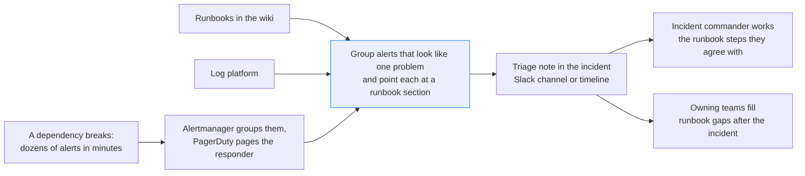
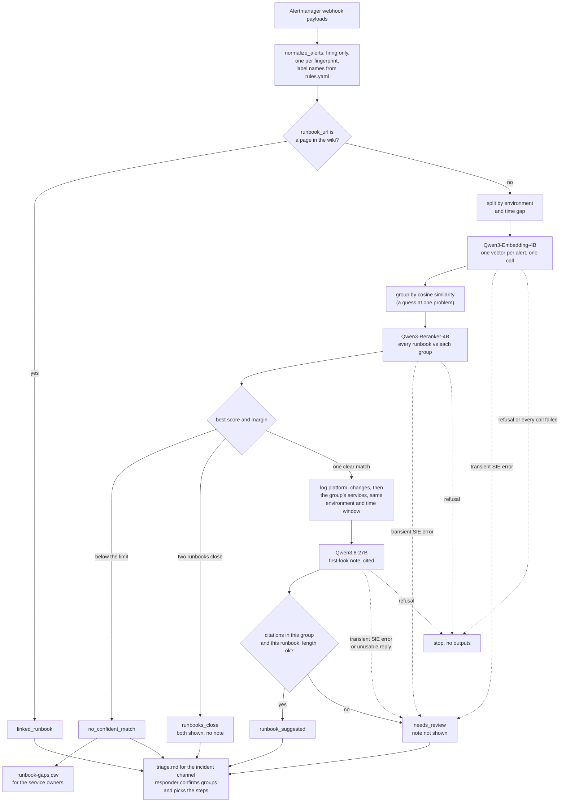

# Match a burst of alerts to the runbooks that fix them

> **This example:** a NOC (network operations center) responder in an alert storm on inherited
> monitoring, where most alerts carry no runbook link.
>
> **How it works:** embeddings group the alerts, a reranker finds matching runbook sections, and a
> language model writes a triage note whose runbook links Python checks.
>
> **Use the same pattern for:** pointing a support ticket at its known-issue article, matching a
> failed deploy's errors to past incidents, matching security alerts to their playbooks.

## Background

In a well-kept monitoring setup, an on-call engineer rarely has to hunt for a runbook. Each
alert rule carries a `runbook_url` annotation, Alertmanager groups related alerts into one
notification by labels like `alertname`, `service` and `env`, and PagerDuty shows the link right
on the incident. The engineer acknowledges the page on their phone, opens the laptop, clicks the
link and follows the steps.

Plenty of setups aren't that well kept. A platform or NOC team that inherited three monitoring
stacks from three acquisitions, or that sits behind a dozen product teams who each write their
own alert rules, gets alerts with inconsistent labels, no runbook link, or a link to a wiki page
that moved two reorganizations ago. When a dependency breaks, about 30 alerts land in a few
minutes across a dozen services. The responder scrolls the list, guesses which alerts are the same
problem seen from different services, searches the wiki for each guess, opens Grafana and the
log platform to check, and writes what they found into the incident timeline. All while the
pager keeps going.

What's already structured: each alert's name, its labels (service, environment, severity), its
start time and fingerprint, Alertmanager's own grouping, and, where someone wrote one, the
runbook link. The runbooks themselves are wiki pages with headings. The logs come from the log
platform, already split into time, service and message. None of that needs a model, so the
recipe takes it as it comes: the webhook bodies Alertmanager posts, a lookup into the wiki, and a
query to the log platform. What isn't structured is the matching: an alert summary in one team's
words, a runbook's "Symptoms" paragraph in another team's, and no link between them.

Why it matters: the first ten minutes of a big incident decide how long it lasts. A responder who
runs the wrong runbook, or treats two incidents as one, loses those minutes. A responder with no
runbook improvises a rollback that may not be the fix.

Here's the job end to end, and the step this recipe takes on:



## The problem

You want the alerts that arrive without a usable runbook link grouped into likely shared
problems, each group matched to the runbook sections that fit it, and a short first-look note
that points at the alerts, the log lines and the runbook steps it used. You also want the links
that already exist used as they are, and every group shown as a suggestion, since alerts that
read alike don't prove a shared cause.

Keyword search on the wiki misses paraphrases ("Charge returns Invalid token" against a runbook
titled "Payment: Charge requests failing"). Grouping by service alone splits one dependency
outage across five services. Asking one chat model "what's going on?" gives you a confident
story that may cite nothing.

For each group the recipe reports what the checks found, and the responder decides:

- **`linked_runbook`**: the alerts carry a runbook link that is a page in the wiki. Nothing is
  matched; the link is shown.
- **`runbook_suggested`**: the best runbook clears the score limit and the note passed its
  checks. The responder confirms the group and the runbook before acting on any step.
- **`runbooks_close`**: two runbooks score within a small margin of each other. Both are shown,
  with no note picking one.
- **`no_confident_match`**: no runbook clears the score limit. That might be a gap in the
  runbooks, or a runbook written in words nobody would search for; whoever owns the service
  finds out which.
- **`needs_review`**: the note cites an alert outside its group or a runbook it wasn't given, runs
  over the line limit, or a call for this group failed. A note that failed its checks isn't
  shown as a note.

The output is one triage note per storm, written to be pasted into the incident's Slack channel
or timeline: each group with its alerts, its runbook section and link, the first-look note and
the log lines the note saw. The responder (usually the incident commander for the first ten
minutes) reads it, splits or merges groups that are wrong, and works the runbook steps they
agree with. Every note is advice; nothing is executed. The `no_confident_match` groups also go
on a short runbook-gap list with the services involved, which the owning teams pick up after the
incident.

It's worth being plain about what the checks on a note prove. They prove every alert ID it cites
is in its group, the only runbook it cites is the one it was given, and it fits in five short
lines. They don't prove the diagnosis is right. A note can cite `[A-01]` and `[RB-01]` and still
make up a step, which is why the responder reads it against the runbook before doing anything.

### Examples

Here are three of the alerts in `data/alertmanager-webhooks.jsonl`, and what should happen to each.

All of this is synthetic, written for this recipe. The service names and fault flags follow the
OpenTelemetry demo (Apache-2.0), and the runbooks and the incident are invented.

**1. Payment charges failing in production.**
- **Input:** "oteldemo.PaymentService/Charge error rate 48% over 5m (threshold 5%)", one of 7 alerts
  across payment, checkout and frontend with no runbook link.
- **What should happen:** the seven should land in one group, the best-scoring runbook should be
  "Payment: Charge requests failing" (RB-01), and the note should pass its checks.
- **Expected outcome:** `runbook_suggested`, RB-01.

**2. Kafka backing up, and no runbook for it.**
- **Input:** "accounting consumer group lag on Kafka topic 'orders' is 48,000 messages and rising",
  one of 5 alerts on accounting, fraud-detection and kafka.
- **What should happen:** no runbook covers Kafka, so no score should clear the limit. No note gets
  written and the group goes on the gap list.
- **Expected outcome:** `no_confident_match`.

**3. Recommendation alerts, and a note that only has to cite them.**
- **Input:** "frontend calls to recommendation ListRecommendations p95 2.1s" (A-27), one of 6 alerts
  on recommendation and frontend.
- **What should happen:** the six should land in one group under RB-03, and the note should say
  only what the group shows. Its checks prove every ID it cites is in the group, not that what it
  says is true, so a wrong claim with a real citation gets through and the responder has to catch
  it.
- **Expected outcome:** `runbook_suggested`, RB-03, with a note that says only what the group
  shows.

On the live run, 7 of 8 cases came out as expected. [What came out](#what-came-out) has the results.

## How we'll solve it

1. **Normalize what the monitoring system sends.** Read Alertmanager webhook payloads (nested
   `labels` and `annotations`, `startsAt`, `status`, `fingerprint`), keep only firing alerts,
   drop duplicate fingerprints, and keep the environment label. Every notification for a group
   repeats all its alerts, so the last notification that mentions a fingerprint says whether
   it's still firing. Each stack names its labels its own way (`service`, `job` or `app`;
   `env` or `environment`), and `rules.yaml` lists the names to try. Each alert gets a short ID
   (`A-01` to `A-32`, in start order) the note can cite. If your stacks send other shapes, this
   is the one function you adapt.
2. **Use the links that already exist.** Alerts with a `runbook_url` annotation that is exactly
   a page in the wiki go straight to `linked_runbook`. Only the rest go further. A link the wiki
   doesn't have (a page that moved) is noted on the group, and the alert is matched like one
   with no link.
3. **Group within real boundaries, then by meaning.** Alerts in different environments, or
   starting more than 30 minutes after the previous one, never share a group. Within those
   boundaries, `Qwen/Qwen3-Embedding-4B` embeds each alert's name, service and summary, and
   Python groups them by cosine similarity. A group is a guess at one problem, labelled as such.
4. **Rank the runbooks for each group.** `Qwen/Qwen3-Reranker-4B` scores every runbook in the
   wiki against the group's alerts. Python applies the score limit and the close-second margin.
5. **Pick the log lines that belong to the group.** From the log platform: configuration, flag
   and deploy changes in the group's environment from 30 minutes before its first alert to 5
   minutes after its last, then lines from the group's services from 5 minutes before its first
   alert to 5 minutes after its last, at most 8 in all. The note shows which lines it saw.
6. **Write and check the note.** `Qwen/Qwen3.8-27B-FP8` writes at most five lines, citing alert
   IDs and the runbook ID, from the group's alerts, those log lines and the chosen runbook.
   Python checks every citation belongs to this group and this runbook, and the length.

If SIE refuses a call outright (a bad key, an unknown model, no credits), the run stops with
SIE's message and writes nothing; if a call fails for a reason that may pass (a timeout, a busy
server) or its reply is missing the expected fields, that group goes to `needs_review` with the
reason, the other groups are still written, and the run stops only if every call fails.

## Picking the models

The grouper is `Qwen/Qwen3-Embedding-4B`, called through SIE's `encode` once per run with every
alert that has no usable link (30 here). It returns one dense vector per alert. Embeddings are
the right tool for "these two alerts say the same thing in different words": "checkout to
payment Charge gRPC calls returning UNKNOWN" and "orders placed per minute down 52% while
payment Charge failures rise" end up close, though they share few words. What it can't tell you
is whether two alerts share a cause. Two alerts in the same words from different environments
look identical to it, which is why the environment and time split happens in Python first. The
grouping threshold is tied to this model's scores (more on that under Try another model).

The matcher is `Qwen/Qwen3-Reranker-4B`, called through `score` once per group, with the group's
alerts as the query and all 10 runbooks as the items. A reranker reads the query and each runbook
together, which suits a short list like this: ten runbooks is few enough to score every one, so
there's no first-stage search to miss the right page. On this data its scores are far apart: a
match comes back at about 0.9997 and the Kafka group's best is 0.0011. That makes the 0.50 limit
easy here, and it doesn't tell you where the line sits on your runbooks.

The writer is `Qwen/Qwen3.8-27B-FP8`, called through `chat_completions` with a strict JSON schema
once per group that has one clear runbook (5 here). It's the only model that writes text a person
reads, so it gets the least room: five lines, the alerts, the log lines and the one runbook, and
the instruction that text in those inputs is something to read, never an instruction. It's
also the biggest model to host, and the easiest one to cut if you'd rather show the ranked
runbook's Check and Mitigate sections as they are.

So: three models, the embedder called once per run, the reranker once per group and the writer
once per matched group, which is 12 calls here instead of one per alert. Grouping, linking, the
score limits, log selection and every check on the note are plain Python reading `rules.yaml`.

## The flow



## How it's built

Everything you'd want to argue about lives in [`rules.yaml`](./rules.yaml): the three model
names, the label and annotation names each stack might use, the time gap that splits a storm,
the grouping threshold, the score limit and close-second margin, which services count as
configuration changes, the log window, and the note's line limits and citation patterns.
[`recipe.py`](./recipe.py) reads top to bottom in the same order as the flow. The two systems
the responder already has are small lookup modules over committed CSV seeds, loaded into an
in-memory SQLite database: [`wiki.py`](./wiki.py) (`find_page(url)`, `runbooks()`) stands in
for the wiki's REST API, and [`log_platform.py`](./log_platform.py) (`search`, `changes`) stands
in for a Loki or Elasticsearch range query.

| Step | Code | SIE call | What it does |
| --- | --- | --- | --- |
| Normalize | `load_webhooks`, `normalize_alerts`, `first_of` | none | Firing alerts only, one per fingerprint (the last notification wins), label names from `alert_labels`. An alert without a fingerprint or a readable `startsAt`, or a payload Alertmanager truncated, becomes a warning at the top of the triage note |
| Use existing links | `link_alerts`, `Wiki.find_page` | none | An exact wiki page (a `#section` anchor or `?query` on the link is ignored) becomes a `linked_runbook` group, one per environment, time window and runbook. A link the wiki doesn't have is noted and the alert goes on |
| Boundaries | `partitions`, `window_index` | none | Split by environment, then wherever the next alert starts more than `max_gap_minutes` later. An alert with no environment label only groups with others that have none |
| Group | `embed_alerts`, `group_alerts`, `group_by_meaning` | `encode` | One call for every remaining alert; average-linkage clustering on cosine similarity inside each boundary, stopping below `min_cosine_similarity` |
| Rank runbooks | `rank_runbooks`, `judge_ranking` | `score` | One call per group. The reply must score every runbook exactly once with a finite number. Below `min_rerank_score` is `no_confident_match`; a second runbook within `close_margin` is `runbooks_close` |
| Log lines | `select_logs`, `LogPlatform.changes`, `LogPlatform.search` | none | Changes from `change_sources` first, then the group's services, in its environment and time window, up to `max_lines` |
| Note | `note_prompt`, `write_note` | `chat_completions` + strict JSON schema | One call per group with one clear runbook |
| Check the note | `check_note` | none | Every alert ID in the text or the `cited_alert_ids` list is in the group; the only runbook cited is the given one, and it's cited in the text; at most `max_lines` lines of at most `max_line_chars`. The patterns take any number of digits, so `A-011` or `RB-010` counts as a citation of something that wasn't given |
| SIE failures | `Calls.call`, `Calls.bad_reply`, `is_fatal`, `stop_message`, `stop_on_refusal` | none | A transient failure or an unusable reply sends the group to review; a refusal, or every call failing, stops the run without outputs |
| Outputs | `render_markdown`, `fence_for`, `write_outputs`, `csv_safe` | none | `triage.md`, `triage.json` and `runbook-gaps.csv`. The log lines in `triage.md` sit in a code fence longer than any run of backticks in them, so a line can't close it. Any CSV cell a spreadsheet would run as a formula gets a leading `'` |

[`selfcheck.py`](./selfcheck.py) checks all of this offline with hand-written payloads and
stand-in model replies (one-hot vectors, fixed scores, fixed notes): resolved and repeated
alerts, label names from three stacks, nanosecond timestamps, a missing environment label, a
truncated payload; exact wiki links against near-identical URLs and a staging link that must not
join production's group; environment and time boundaries; the score limit and the close second;
log selection by environment, service and window; a dozen bad notes (an alert from another
group, two IDs in one bracket, `A-011`, another runbook, `RB-010`, a runbook named only in the
JSON field, too many or too long lines); the prompt's injection line; the committed data and
that `make_data.py` rebuilds it byte for byte; the whole flow end to end; and the SIE failure
rule with a transient error, a refusal, every call failing, replies missing their key, a NaN
score, a zero vector and a duplicated score. [`make_data.py`](./make_data.py) writes the three
data files.

## Run it

**Run this recipe using [SIE Serverless](https://superlinked.com/serverless?utm_source=github&utm_medium=docs&utm_campaign=sie-cookbook&utm_content=sre-match-alerts-to-runbooks), [SIE Cluster](https://superlinked.com/docs/deployment?utm_source=github&utm_medium=docs&utm_campaign=sie-cookbook&utm_content=sre-match-alerts-to-runbooks) or [SIE Local](https://superlinked.com/docs/quickstart?utm_source=github&utm_medium=docs&utm_campaign=sie-cookbook&utm_content=sre-match-alerts-to-runbooks).** The code runs on your machine either way. With SIE Serverless you pay per call and there are no GPUs to manage yourself: get an [SIE API key](https://console.superlinked.com/console/keys?utm_source=github&utm_medium=docs&utm_campaign=sie-cookbook&utm_content=sre-match-alerts-to-runbooks) and read the [API docs](https://superlinked.com/docs/reference/api?utm_source=github&utm_medium=docs&utm_campaign=sie-cookbook&utm_content=sre-match-alerts-to-runbooks). To run the models yourself, start from the [SIE repo](https://github.com/superlinked/sie).

You need [uv](https://docs.astral.sh/uv/) and an SIE API key
([create one](https://console.superlinked.com/console/keys?utm_source=github&utm_medium=docs&utm_campaign=sie-cookbook&utm_content=sre-match-alerts-to-runbooks)).

```bash
cp .env.example .env   # then set SIE_API_KEY
uv run recipe.py
uv run selfcheck.py    # optional: offline checks, no SIE call
uv run make_data.py    # optional: rewrite data/
```

`uv run` installs this recipe's few dependencies into its own `.venv` on the first run. Each run
writes `runs/<timestamp>/`; `--output DIR` changes that. A run makes 12 SIE calls on this data: 1
to the embedder, 6 to the reranker (one per group without a link) and 5 to the note model. The
first calls can wait a few minutes while SIE Serverless starts the three models; our runs on
2026-11-04 (UTC), with the models already warm, took 17 s and 19 s.

## What came out

### The three examples

**1. Payment charges failing in production.**
- **Expected outcome:** `runbook_suggested`, RB-01.
- **What came back:** `runbook_suggested` RB-01 at 0.9998, and the note passed its checks.
- **Verdict:** Pass.

**2. Kafka backing up, and no runbook for it.**
- **Expected outcome:** `no_confident_match`.
- **What came back:** `no_confident_match`, best RB-09 at 0.0011, no note, one row in
  `runbook-gaps.csv`.
- **Verdict:** Pass.

**3. Recommendation alerts, and a note that only has to cite them.**
- **Expected outcome:** `runbook_suggested`, RB-03, with a note that says only what the group
  shows.
- **What came back:** `runbook_suggested` RB-03 at 0.9998, and the note passed its checks. Its
  second line in the latest run says "impacting frontend checkout and product views
  [A-14][A-23][A-27]".
- **Verdict:** Miss. The status and the runbook are right, but nothing in the group mentions
  checkout. Every citation is in the group, so
  the checks can't see it, and only the responder reading the note can.

### Results

On the two live runs on 2026-11-04, 7 of 8 cases came out as expected. The miss is the
recommendation group (G3), for what its note says.

**Where it works:** each cause's alerts land in their own group under the right runbook:
`paymentFailure` (RB-01), `adHighCpu` (RB-02) and `productCatalogFailure` (RB-04), and
`recommendationCacheFailure` gets that far too (RB-03). `kafkaQueueProblems` goes on the gap list with no improvised note,
since no runbook covers Kafka. The runbooks for services that are fine are never chosen (RB-05 to
RB-10), links that already exist get used as they are (A-29, A-30), and staging's charge errors stay
out of production's group (A-31, A-32).

**Where it fails:** a note can pass its checks and still say something untrue, like G3's checkout
claim, and that's the one to worry about. This run also didn't test a messy storm: it's one storm
with five tidy faults, and only grouping values from about 0.635 to 0.675 separate them. Log lines
are picked by service and time, so a note can see another fault's lines (G1 did).

The input is one storm, incident INC-4127 on 2026-10-14, in [`data/`](./data):

- `alertmanager-webhooks.jsonl`: 28 webhook bodies from four monitoring stacks, one per line,
  carrying 59 alert entries for 33 fingerprints. One of them, a cart latency alert from before
  the storm, resolved, so 32 alerts are firing. Three stacks name their labels differently
  (`service`, `job` or `app`; `env` or `environment`; `severity` or `priority`; `summary` or
  `description`), and only the payments team's two alerts carry a `runbook_url`.
- `wiki_runbooks.csv`: the wiki seed, 10 runbooks (`RB-01` to `RB-10`) with their URL, owner
  team and Symptoms, Check, Mitigate and Escalate sections.
- `logs.csv`: the log platform seed, 29 lines from production and staging, including a flagd
  configuration change and a staging deploy.

> **All of it is synthetic.** The alerts and log lines are written to look like the
> [OpenTelemetry demo](https://github.com/open-telemetry/opentelemetry-demo) (Apache-2.0) with
> the feature flags `paymentFailure`, `adHighCpu`, `recommendationCacheFailure`,
> `productCatalogFailure` and `kafkaQueueProblems` on, using the demo's service names. They were
> not captured from a running demo. The runbooks are invented, and every URL is on
> `example.internal`. [`make_data.py`](./make_data.py) writes all three files and rebuilds them
> byte for byte.

Both runs used the settings as first written and gave 7 groups and 12 SIE calls, and all five notes
passed their checks. Treat that as a demo that the wiring works, not as a measure of accuracy. One
storm with five tidy faults tells you each path through the recipe runs, not how often a real storm
gets grouped right.

A few things worth noticing:

- **The staging near miss is the reason the environment split exists.** A-31 says "Charge error
  rate 100%" and A-32 says "Payment request failed. Invalid token.", the same words production
  uses. Grouped by meaning alone, they'd have joined G1 and inherited its flag diagnosis. Split
  first, they got staging's own log lines, and the note found a different story (from
  `triage.json`, abridged):

  ```json
  "group": "G7",
  "status": "runbook_suggested",
  "env": "staging",
  "log_lines": [
    "2026-10-14T09:04:30Z argocd [info] sync payment to v1.9.0 in staging: card-processor client upgraded",
    "2026-10-14T09:14:02Z payment [error] Payment request failed. Invalid token. card processor sandbox rejected the API key",
    ...
  ],
  "note": [
    "Payment Charge is failing 100% [A-31] due to invalid API token in sandbox [A-32].",
    "Logs show card processor rejected the API key after a v1.9.0 client upgrade.",
    "Check traces for error messages and loyalty level to rule out feature flags [RB-01].",
    "If the paymentFailure flag is off, roll back the last payment deploy [RB-01].",
    "Escalate to payments on-call if errors persist 15 minutes after mitigation [RB-01]."
  ]
  ```

  Same runbook, opposite branch of it: production's note says turn the flag off, staging's says
  roll back the deploy.
- **The catalog group is the closest call in the storm.** RB-10 ("Feature flags: flagd
  unavailable") scored 0.8565 against RB-04's 0.9999, because the catalog errors literally say
  "Product Catalog Fail Feature Flag Enabled". That's 0.14 apart, outside the 0.10
  `close_margin`, so the note was written. With a margin of 0.15 this group would have come out
  `runbooks_close`. We left the margin where it was.
- **A passing note is not a correct note.** In the latest run, G3's second line reads "Latency
  and errors spiked as memory hit limits, impacting frontend checkout and product views
  [A-14][A-23][A-27]". A-27 is the frontend's calls to ListRecommendations being slow; nothing in
  the group mentions checkout. Every citation is in the group, so the checks pass, and that's
  exactly the limit described under The problem. (The first run made the same checkout claim on
  its third line. The wording of every note changed between the two runs, even at temperature 0;
  the groups, scores and statuses didn't.)
- **The log window is by service and time, not by operation.** G1 (payment) saw two
  product-catalog lines, because checkout and the frontend log both faults in the same minutes.
  The note ignored them this time; Potential improvements has the fix.
- **The Kafka group gets nothing, on purpose.** Its best score was 0.0011, so there's no note and
  no improvised advice, just a row in `runbook-gaps.csv`:

  ```csv
  group,env,services,alert_ids,best_runbook,best_score
  G4,production,accounting;fraud-detection;kafka,A-05;A-10;A-15;A-20;A-25,RB-09,0.0011
  ```

  The best of a bad lot was the frontend proxy runbook, which is about as related to Kafka as
  the coffee machine.

### What you do next

The responder, usually the incident commander for the first ten minutes, pastes the triage note into
the incident channel, splits or merges any group that's wrong, and reads each note against its
runbook before working the steps they agree with. Nothing is executed for them. After the incident,
the owning teams pick up the `runbook-gaps.csv` rows, here the Kafka group, and write the runbook
that was missing.

## Potential improvements

- **Point it at your own systems.** `normalize_alerts` reads Alertmanager's webhook body; if a
  stack sends another shape, that's the one function to adapt, and `alert_labels` in
  `rules.yaml` takes the label names each stack uses. `wiki.py` and `log_platform.py` are the
  two lookups to replace with calls to your wiki's API and your log platform's query API.
- **Tune the thresholds on your own incidents.** `min_cosine_similarity` (how alike alerts must
  be to share a group), `max_gap_minutes`, `min_rerank_score` (below it a group is
  `no_confident_match`), `close_margin`, the note's line limits and the log window are all in
  `rules.yaml`. They are starting points. On this data only grouping values from about 0.635 to
  0.675 separate the five production causes.
- **Swap models** under `models` in `rules.yaml`, one line each.
- **Know what sends a group where.** A group gets `no_confident_match` instead of an improvised
  note when no runbook scores above `min_rerank_score`. It gets `needs_review` when its note
  cites an alert from another group, a different runbook or no runbook, or runs over the line
  limits, or when one of its calls failed.
- **Select log lines by operation or trace.** Today a group sees every line from its services in
  its window, so a shared service like checkout brings in another fault's lines. Filtering on
  the operation named in the alerts (`Charge`, `GetProduct`) or following trace IDs would keep
  the note's evidence to its own problem.
- **Use Alertmanager's own grouping and inhibition.** The recipe keeps each alert but ignores
  which notification group it arrived in. Where a stack's grouping is good, it could seed the
  groups instead of being rediscovered.
- **Try a smaller note model.** On the earlier 28-alert version of this data, `Qwen/Qwen3.5-4B`
  wrote all four notes and three passed the checks. Or drop the note and show the ranked
  runbook's Check and Mitigate sections as they are.

**Pro-tip:** tune `min_cosine_similarity` on a few of your own past incidents before you trust
the runbook matches.

## Try another model

Each model is one line under `models:` in `rules.yaml`. We swapped one model at a time, changed
nothing else, and ran the recipe using SIE Serverless on 31 Oct 2026, on the earlier version of this data
(the same 28 production alerts as flat records, without the linked and staging alerts or the
environment split). We haven't rerun the swaps on the 32-alert storm, and the status names were
then `runbook` and `no_runbook` (now `runbook_suggested` and `no_confident_match`).

| `rules.yaml` key | Swap in | What happened on this data |
| --- | --- | --- |
| `embed` | `tencent/R3-embedding-0.6b` | 17 groups instead of 5, so 14 LLM notes instead of 4. Every payment, ad, recommendation and catalog group still got its own runbook, but A-08 alone scored 0.12 and was reported as a runbook gap. `min_cosine_similarity: 0.65` was set with Qwen3-Embedding-4B's scores; this model needs its own value. |
| `embed` | `Snowflake/snowflake-arctic-embed-l-v2.0` | 19 groups instead of 5. A-14 (recommendation) was grouped with A-06 (ad) under RB-02, and A-08 and A-27 became runbook gaps. The 0.65 threshold does not fit this model's scores either. |
| `rerank` | `Qwen/Qwen3-Reranker-0.6B` | Same 5 groups, same runbook for each and the Kafka group still a gap. Top scores 0.995 to 0.999, the gap 0.0004, so 0.50 still splits them widely. |
| `rerank` | `tencent/R3-rerank-0.6b` | Same 5 groups and same runbooks, but the scores are squeezed: matches 0.74 to 0.77, the Kafka gap 0.27. 0.50 still separates them, with far less room. |
| `note` | `Qwen/Qwen3.5-4B` | All 4 notes written. 3 passed the checks; the ad group's note cited no runbook, so it went to `needs_review`. |
| `note` | `google/gemma-4-31B-it` | Did not run: SIE Serverless answered "Generation route is unavailable for this deployment" on both tries. |

See [MODELS.md](../../MODELS.md) for every model these recipes use.

## Run it using SIE Cluster or SIE Local

The same code runs on your machine and uses SIE Cluster or SIE Local. Set `SIE_BASE_URL` in `.env`; an API key
is then optional. The table gives the SIE v0.10.1 image each model runs on, from SIE's
[compatibility matrix](https://github.com/superlinked/sie/blob/main/docs/compatibility.md).

| `rules.yaml` key | Model | Image | Tested on |
| --- | --- | --- | --- |
| `embed` | `Qwen/Qwen3-Embedding-4B` has no published image in v0.10.1: set `Qwen/Qwen3-Embedding-8B` instead | `cuda12-default` | L4 |
| `rerank` | `Qwen/Qwen3-Reranker-4B` | `cuda12-default` | L4 |
| `note` | `Qwen/Qwen3.8-27B-FP8` | `cuda13-sglang-cu130` | H100 80GB |

One SIE server runs one image, so these 2 images need SIE Cluster: the
[sie-cluster Helm chart](https://github.com/superlinked/sie/tree/main/deploy/helm/sie-cluster)
with one worker pool per image routes each model to its pool. See
[SELF_HOSTING.md](../../SELF_HOSTING.md) for the values file.

## Data and licenses

All data is synthetic and written by [`make_data.py`](./make_data.py). The service names, error
messages and fault flags follow the
[OpenTelemetry demo](https://github.com/open-telemetry/opentelemetry-demo) (Apache-2.0); nothing
was copied from a running demo. The runbooks, the incident and every URL (all on
`example.internal`) are invented.

## Files

- `recipe.py`: the pipeline
- `wiki.py`: the wiki lookup (runbook pages by URL, every runbook)
- `log_platform.py`: the log platform lookup (lines and changes by environment, service and time)
- `rules.yaml`: model IDs, label names and every threshold
- `data/`: the webhook bodies, the wiki seed and the log platform seed
- `make_data.py`: rebuilds `data/`
- `selfcheck.py`: offline checks, no SIE call
- `pyproject.toml`, `uv.lock`: this recipe's dependencies

See the SIE task page for [reranking](https://superlinked.com/rerank?utm_source=github&utm_medium=docs&utm_campaign=sie-cookbook&utm_content=sre-match-alerts-to-runbooks).
