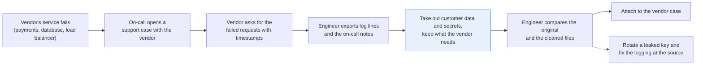
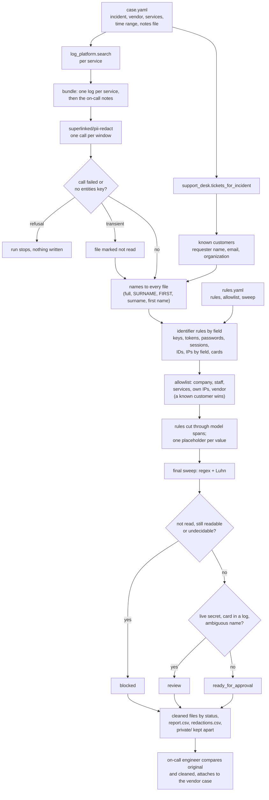

# Redact secrets and customer data from logs before you share them

> **This example:** the on-call engineer attaching an incident's logs to the card processor's
> support case.
>
> **How it works:** a PII model and plain rules find keys, tokens and customer details, each gets
> the same placeholder in every file, and a final sweep blocks anything still readable.
>
> **Use the same pattern for:** a stack trace for a public bug report, logs for an outside security
> auditor, the incident channel before a company-wide readout.

## Background

Plenty of incidents end at someone else's door. The payment provider is slow, the managed
database drops connections, the cloud provider's load balancer returns 502s. The fix isn't in
your code, so the on-call engineer opens a support case with the vendor, and the first thing the
vendor's support engineer asks for is logs: "please attach the requests that failed, with
timestamps". (They always ask for timestamps. Then they ask for the timezone.)

So the engineer builds a log bundle at their laptop. They search the log platform by service,
time range and request ID, export the matching lines from the services that talk to the vendor,
and paste in their own incident timeline from the on-call notes, stack trace and all. Then they
attach it to the case in the vendor's support portal.

Those lines were written for your own team, not for a third party. They carry customer emails,
client IPs, user IDs and session cookies, now and then a bearer token in a debug header, an API
key or a database connection string with its password, and, on a bad day, a full card number a
debug line should never have written. The on-call notes name the customer who reported it. None
of that helps the vendor, and all of it leaves the company the moment the file is attached.

What the vendor does need is everything else: the timestamps, the hostnames and ports, the error
text and status codes, the latencies, the build and library versions, the endpoint you called and
the shape of the request (which fields you sent, the amount and the currency; for a database
vendor, the SQL with its literal values taken out). Today the engineer either greps for what they
can think of, which misses things, or strips half the file, and the vendor writes back asking for
the logs again. Meanwhile the incident is still open.

Some of this is already structured. The log platform parses fields: `user_id=`, `email=`,
`client_ip=`, `session_id=`, `request_id=`, `host=`, the `Authorization` header and the payload's
`card` are labelled, and plain rules handle them without a model. The payload's `name` is
labelled too, but no rule reads it. The customer's own support ticket isn't attached to the
vendor case, but its fields (requester, organization) tell the recipe whose name and email to
look for before it reads a word, and that is how the name in the payload is found. What no
field covers is the free text: a customer named in the on-call notes, a first-name sign-off, an
ID in a stack trace with nothing to say whose it is.

In this recipe both systems are small lookup modules. [`log_platform.py`](./log_platform.py)
stands in for your log platform's search API (one service between two timestamps) and
[`support_desk.py`](./support_desk.py) for a ticket search by linked incident. Each loads a
readable CSV seed from `data/` into an in-memory SQLite database, so you can see exactly what a
real call would hand back and swap in the real one.

Here's the job end to end, and the step this recipe takes on:



## The problem

You want a bundle the vendor can debug from and that holds nothing the vendor must not see. That
means:

- **Taken out:** API keys, tokens, passwords, connection-string credentials, session IDs, card
  numbers, and the customer's emails, IPs, user IDs and names.
- **Kept readable:** hostnames and your own IPs, request IDs, timestamps, error text, versions,
  the vendor's own endpoints, and the request and query shapes.
- **Consistent placeholders across files**, so the vendor can follow one customer's failed
  requests through two services (`[USER_ID_1]` is the same user in the checkout log and the
  worker log). The mapping back to real values stays on the engineer's machine, so when the
  vendor replies about `[USER_ID_2]`, the engineer knows who that is.

Which categories go and which stay is the company's call, usually the security team's, so it
comes in as a list in `rules.yaml`, not as code.

A PII model alone tags request IDs as usernames and your own hosts as customer IPs. Regex alone
never finds a customer's name in the on-call notes. And no redaction can promise it found
everything: a name the model didn't tag and no rule describes stays readable, and the final sweep
only catches shapes it knows. That's why a person still looks before anything is attached.

The recipe sends the raw bundle to SIE's PII model before anything is redacted, so SIE has to be
a processor your company has already approved for this data. For each file it reports what the
checks found:

- **`ready_for_approval`**: everything the model and rules found is taken out and the sweep found
  nothing readable. The on-call engineer compares the original and the cleaned file side by side
  and, if they agree, attaches it to the vendor case.
- **`review`**: cleaned, but something needs a person before it goes: a live secret or a card
  number in a log (the copy is clean, but the key has to be rotated and the logging fixed at the
  source), or a name that fits more than one person.
- **`blocked`**: something is still readable, a value the rules can't decide (a bare UUID that
  might be the vendor's charge ID, which they need, or a customer's ID, which they don't), or a
  part of the file the model didn't read. It isn't attached until a person fixes it.

The recipe never uploads anything to the vendor. The engineer does that, after approving.

### Examples

Here are three of the inputs in `data/`, and what should happen to each.

All of this is synthetic, written for this recipe: every person, company and value is invented, and
the secrets are fake.

**1. A version number that looks like an IP.**
- **Input:** `build=4.18.302.7 host=10.0.4.17 msg="service started"` (checkout log).
- **What should happen:** `4.18.302.7` can't be an IP (302 is too big for any part of one), and
  `10.0.4.17` is your own host, so both stay readable for the vendor.
- **Expected outcome:** kept as is. (The checkout log as a whole still goes to `review`, for the
  bearer token elsewhere in it.)

**2. A card number in a debug payload.**
- **Input:**
  `payload={"amount": 4210, "currency": "USD", "card": "4111 1111 1111 1111", "exp": "09/29", "name": "Delphine Marchetti", ...`
  (payment worker log).
- **What should happen:** a rule on the `card` field masks the card, the customer's name is found
  from the support ticket's requester fields, and the amount, currency and field names stay so the
  vendor sees the request's shape.
- **Expected outcome:** `review`: the card is masked to `XXXX XXXX XXXX 1111`, and the logging has
  to be fixed at the source.

**3. A password-reset link with an email and a token in it.**
- **Input:** `link=https://shop.corvane.example/account/reset?email=t.okonkwo@fernmail.example&token=Rk7pQ2vX9mL4sT8wZ1cB6nH3`
  (checkout log).
- **What should happen:** nothing in the link should stay readable. We wrote this one expecting the
  model to tag the whole URL as one piece and the email rule to cut through it, with the token still
  taken out where the two overlap.
- **Expected outcome:** nothing readable, with the whole URL tagged as one piece.

On the live run, 12 of 13 cases came out as expected. [What came out](#what-came-out) has the
results.

## How we'll solve it

1. **Start from the structured fields.** The log lines with their parsed fields come from the log
   platform for each service the case names, inside its time range; the on-call notes come as
   a file; the customer ticket's requester and organization come from the support desk. The
   requester's name and email are known before the model reads anything. The keep and remove
   lists, the company's own names and the vendor's own names come from `rules.yaml`.
2. **Find personal data in the free text.** `superlinked/pii-redact` reads each file in windows of
   about 150 words and tags names, companies, emails, phones, IPs, IDs and URLs.
3. **Carry each name to every file.** A name found once is redacted everywhere in the bundle,
   also as "SURNAME, FIRST", the surname alone or the first name alone. A known customer wins over
   the allowlist when the names collide.
4. **Apply the identifier rules by field.** Regex per type, in order: API keys, bearer tokens,
   whatever else an `Authorization` header holds, session cookies and the password in a
   connection string (redacted; a live key also sends the file to `review` to rotate it), while
   the connection string's host, port and database name stay; request, trace and deploy IDs
   (kept); user and customer IDs (redacted); IPs by field, so `host=` and `upstream=` are kept
   while `client_ip=` and `X-Forwarded-For` are redacted even when private; cards by the Luhn
   check (the check digit every card number ends with, which most other 16-digit numbers fail),
   masked to the last four, and a card-shaped number that fails Luhn next to the word "card" is
   redacted and sent to review. In a JSON payload the field names stay and only the values the
   remove list names are replaced, so the vendor still sees the request's shape. Where a model span overlaps a rule's span, the rule decides its part and the
   rest of the model's span is still redacted.
5. **Keep your own names and the vendor's readable.** The allowlist holds the company, its
   on-call staff, its services and its own public IPs, plus the vendor's hostnames and endpoints,
   matched as whole terms. An IP a `host=` field named anywhere in the bundle stays readable in
   the notes too.
6. **Assign placeholders and sweep.** One placeholder per value across the bundle, then regex and
   Luhn checks re-read the cleaned text, and any hit blocks the file.
7. **Write the bundle for approval**: the cleaned files, a report per file with what was taken out
   and why, by line number (never the value), and the private mapping in a separate folder that is
   never attached.

If SIE refuses a call outright (a bad key, an unknown model, no credits), the run stops with
SIE's message and writes nothing; if a call fails for a reason that may pass (a timeout, a busy
server) or its reply is missing the `entities` key, that file is `blocked` as not read, the others
are still written, and the run stops only if every call fails.

## Picking the model

There's one model here, `superlinked/pii-redact`, called once per window of at most 150 words.
On this bundle every file fits in one window, so a run makes 3 calls. Log lines are token-dense
(a UUID is a dozen or more model tokens), so the windows sit well under the model's limit, and
each call asks SIE to fail rather than cut a window short: a window that still doesn't fit blocks
its file as not read. In our test SIE Serverless read a 600-word, UUID-dense text to its end, so the
window size is a margin, not a measured limit. It's SIE's PII model: two span
extractors, `urchade/gliner_multi_pii-v1` and `numind/NuNER_Zero`, composed on the server, with
spans scoring 0.6 or more kept, the two models' spans unioned and person names propagated. You give it a list of labels (here its 36 default personal-data types plus
`organization`, all in `rules.yaml`) and it returns spans with a label, offsets and a score
through SIE's `extract` call.

It's the right tool for the part no field labels: "Brightwater Ceramics (Delphine Marchetti)" in
the notes, a first name on its own, a token sitting in a URL's query string. It's the wrong tool
for the labelled fields, and the checkout log shows why: it tagged request IDs as "username",
`10.0.4.17` in `host=10.0.4.17` as an IP address, and the reset line's request ID as an account
number. Those would all be redacted if the model decided. So the model only proposes; the field rules and the allowlist decide what they cover, and no generative
model makes the decision anywhere in the flow.

## The flow



## How it's built

Everything you'd want to argue about lives in [`rules.yaml`](./rules.yaml): the model and its
labels, the identifier rules in the order they run (each with its pattern, check, action and
review reason), the allowlist, placeholder names, the sweep patterns and every threshold. The
vendor case itself (incident, vendor, services, time range, notes file) is in
[`data/case.yaml`](./data/case.yaml). [`recipe.py`](./recipe.py) reads top to bottom in the
order of the flow; most of it is the redaction core (names, rules, allowlist, placeholders,
sweep), which you can lift into another project as is.

| Step | Code | SIE call | What it does |
| --- | --- | --- | --- |
| Build the bundle | `load_case`, `utc_time`, `build_bundle`, `log_platform.search`, `log_platform.export` | none | One log file per service from the log platform, inside the case's time range, then the notes. Both ends of the range must carry a timezone and are compared as UTC times, not text, so `+02:00`, an unquoted YAML timestamp and fractional seconds all select the right lines. A service with no lines in the window, or a notes name that leads out of `data/`, raises an error before any SIE call |
| Known customers | `known_customers`, `flag_no_ticket`, `support_desk.tickets_for_incident` | none | The requester name, email and organization of every ticket linked to the incident, by exact incident ID. Only the fields; the ticket's text never enters the bundle. With no linked ticket the run prints a warning and every file goes to review, since only the model looked for the customer |
| Find personal data | `detect_pii`, `guarded` | `extract` | One call per window of at most 150 words, with `overflow_policy: error` so a window too long to read whole fails (`InputTooLongError`, blocked as not read) instead of being cut short. A transient failure or a reply without `entities` marks the file as not read; a refusal stops the run (`SIEStopped`, `is_fatal`, `stop_message`), and so does a run where every call failed (`CallLog.stop_if_all_failed`). A span whose offsets don't match its text blocks the file |
| Carry names | `known_mentions`, `propagate_names`, `name_form_spans`, `second_spellings` | none | Known customers and model-found names everywhere in the bundle, also as "SURNAME, FIRST", the surname alone and the first name alone (as written, in capitals or capitalized). Emails and customer IDs in any capitals or spelling |
| Identifier rules | `identifier_spans`, `learned_keeps`, `ipv4_valid`, `luhn_valid`, `mask` | none | The rules in `rules.yaml` order. A rule acts on its `value` group, so the field name stays. Host IPs learned from `host=` and `upstream=` are kept in every file; the same IP logged as a client blocks the file. Any `Authorization` header value is taken out; a value that isn't a bearer token (Basic, or a key with no scheme) also blocks the file, like any other loose look-alike no rule matched (a bare UUID, an IPv6 client address). A rule skips a value only when it lies wholly inside an allowlisted term, so `felix@corvane.example` is still an email |
| Allowlist | `apply_allowlist`, `released_terms`, `known_releases` | none | Company, staff, services, vendor and own IPs stay, as whole terms. A known customer's name wins over the list, and the file goes to review to check who is meant |
| Rules cut model spans | `outside_ruled`, `worth_redacting`, `merge_spans` | none | The rule decides its own range; the rest of the model's span stays redacted under one placeholder, unless what's left is one word like `request_id=` or `Bearer` |
| Placeholders | `Placeholders.assign`, `replacement` | none | One placeholder per value across the bundle; a short name that fits two known people goes to review |
| Sweep and status | `redact`, `residual_sweep`, `Document.status` | none | Regex for emails (URL-encoded too), IPs, UUIDs, JWTs, bearer tokens, API keys, phones, labelled numbers, wrapped tokens, connection passwords, readable `Authorization` values, labelled secrets (`client_secret=`, `"password":`), session IDs, URL secrets, AWS access keys, PEM private keys, GitHub and Slack tokens, `sk_live_` style keys, `Set-Cookie` and framework session cookies (`JSESSIONID=`), plus a Luhn check that allows spaces, dots or dashes between digits, on the cleaned text. Any hit blocks the file |
| Write | `write_outputs`, `report_rows`, `redaction_rows`, `csv_safe` | none | Cleaned files under `ready_for_approval/`, `review/` or `blocked/`, `report.csv`, `redactions.csv`, and `private/` (mapping and originals). Every CSV cell goes through `csv_safe` |

[`selfcheck.py`](./selfcheck.py) checks all of this offline with hand-written strings, the
committed `data/` and hand-written stand-in model replies: the lookups and the time window
(unquoted YAML, `+02:00`, fractional seconds, no timezone), a run with no linked ticket, host
versus client IPs, the near misses, cards with any separator, connection strings with `/` or `@`
in the password, URL-encoded emails, `Authorization` headers of every kind, wrapped tokens,
sessions, the overlap rule, name forms, allowlist collisions, every sweep pattern, the bundle's
statuses, and the SIE error rule (transient, an over-long window, refusal, every call failed, a
reply missing its key). It never calls SIE.

## Run it

**Run this recipe using [SIE Serverless](https://superlinked.com/serverless?utm_source=github&utm_medium=docs&utm_campaign=sie-cookbook&utm_content=sre-redact-logs-before-sharing), [SIE Cluster](https://superlinked.com/docs/deployment?utm_source=github&utm_medium=docs&utm_campaign=sie-cookbook&utm_content=sre-redact-logs-before-sharing) or [SIE Local](https://superlinked.com/docs/quickstart?utm_source=github&utm_medium=docs&utm_campaign=sie-cookbook&utm_content=sre-redact-logs-before-sharing).** The code runs on your machine either way. With SIE Serverless you pay per call and there are no GPUs to manage yourself: get an [SIE API key](https://console.superlinked.com/console/keys?utm_source=github&utm_medium=docs&utm_campaign=sie-cookbook&utm_content=sre-redact-logs-before-sharing) and read the [API docs](https://superlinked.com/docs/reference/api?utm_source=github&utm_medium=docs&utm_campaign=sie-cookbook&utm_content=sre-redact-logs-before-sharing). To run the models yourself, start from the [SIE repo](https://github.com/superlinked/sie).

You need [uv](https://docs.astral.sh/uv/) and, for SIE Serverless, an SIE API key
([create one](https://console.superlinked.com/console/keys?utm_source=github&utm_medium=docs&utm_campaign=sie-cookbook&utm_content=sre-redact-logs-before-sharing)).

```bash
cp .env.example .env   # then set SIE_API_KEY
uv run recipe.py
uv run selfcheck.py    # optional: offline checks, no SIE call
```

`uv run` installs this recipe's few dependencies into its own `.venv` on the first run. Each run
writes `runs/<timestamp>/`. The first call can wait a few minutes while SIE Serverless starts the
PII model. A warm run takes about 2 seconds.

## What came out

The input is one fictional incident at a fictional payments company, Corvane: checkout times out
because the card processor it calls, cardvault, has a latency spike, and the on-call engineer
opens a case with cardvault's support. [`data/case.yaml`](./data/case.yaml) names incident
INC-2207, the services `checkout-api` and `payment-worker`, the window 09:10 to 09:55 UTC on
27 Oct 2026 and the notes file. [`data/log_platform.csv`](./data/log_platform.csv) holds the
log events (plus one checkout line before the window and one `search-api` line, which the
lookup leaves out), [`data/oncall-notes.txt`](./data/oncall-notes.txt) the notes and
[`data/support_desk.csv`](./data/support_desk.csv) two tickets, one linked to INC-2207. The
bundle is the checkout log, the payment worker log and the on-call notes. The customer's support
ticket is read for its requester fields only and is not attached.

> **All of it is synthetic.** Every person, company, address and value is invented. Emails and
> hosts use reserved `.example` domains; public IPs are in the RFC 5737 documentation ranges
> (198.51.100.0/24, 203.0.113.0/24); the card is the well-known 4111 1111 1111 1111 test number;
> the bearer token is a JWT-shaped string with a fake payload and signature, the API key is a
> made-up value in a made-up `cvn_live_` format, and the database password, session cookie and
> reset token are random strings. Only the shapes are real.

The run on 2026-11-04 (UTC) made 3 SIE calls.

### The three examples

**1. A version number that looks like an IP.**
- **Expected outcome:** kept as is. (The checkout log as a whole still goes to `review`, for the
  bearer token elsewhere in it.)
- **What came back:** kept. The checkout log went to `review` for its token, with 16 redactions in
  all.
- **Verdict:** Pass.

**2. A card number in a debug payload.**
- **Expected outcome:** `review`: the card is masked to `XXXX XXXX XXXX 1111`, and the logging has
  to be fixed at the source.
- **What came back:** the payment worker log went to `review` with 5 redactions, the line reading
  `"card": "XXXX XXXX XXXX 1111", "exp": "09/29", "name": "[PERSON_1]"` (quoted below).
- **Verdict:** Pass.

**3. A password-reset link with an email and a token in it.**
- **Expected outcome:** nothing readable, with the whole URL tagged as one piece.
- **What came back:** `link=[URL_1]=[EMAIL_2]&token=[TOKEN_3]`: nothing readable but `=` and
  `&token=`. The model returned three spans instead of one.
- **Verdict:** Miss. Nothing leaked, but the rule for overlapping spans never ran on this run, so
  this link says nothing about it. `selfcheck.py` covers that rule with stand-in replies.

### Results

On the live run on 2026-11-04, 12 of 13 cases came out as expected. The reset URL is the
one that didn't: nothing in it stayed readable, but not for the reason we expected (more below).

**Where it works:** the rules do most of the work (18 of the 25 redactions). What the vendor needs
stays readable (the build number, the 16-digit order ID, the status page IP, the vendor endpoint),
while a customer's private IP next to your own host still goes. The checkout log and the payment
worker log lose their token, key and card and go to `review`; the connection string loses only its
password, and the session cookie its ID. One customer keeps one placeholder across files, the
on-call notes hide the customer and keep your own staff, and a bare UUID stops the notes file until
a person decides.

**Where it fails:** the reset URL came out clean by a different route than we meant, and the model
over-redacted the words "password reset". The one to worry about is what the run didn't test: shapes
the rules miss pass both the rules and the sweep (a double-encoded email, a card with three or more
characters between digit groups), and a name the model didn't tag and no rule describes stays
readable. That's why a person still looks before anything is attached.

These cases show the wiring works; they don't measure accuracy. Thirteen hand-written
cases in three files tell you each path through the flow does what it says, not how often a
real bundle slips past it.

A few things worth noticing:

- **The rules did most of the work, which is the point.** Of the 25 redactions, 18 came from an
  identifier rule, 3 from the support desk's requester fields and 4 from the PII model (the
  phrase "password reset", the reset URL, its token and the lone "Delphine" in the notes). The
  model's own guesses on the labelled fields (request IDs as usernames, `host=` IPs as customer
  IPs) were all overruled by the field rules. It also tagged our own path `/v2/checkout` as a
  URL; that path is on the allowlist as one of Corvane's endpoints, so it stays.
- **The reset URL came out fine, but not for the reason we expected.** We expected the model
  to tag the whole URL as one span, so that the email rule would cut through it and the overlap
  rule would keep the token redacted. Instead the model returned three spans: the URL up to
  `?email`, the email, and the token on its own (as an "api key"). So the overlap rule never
  fired here. `selfcheck.py` checks it with a stand-in reply that tags the whole URL, and with
  one that stops before the token, which the sweep then blocks.
- **The model over-redacts a little.** It tagged the words "password reset" in
  `msg="password reset sent"` as a password, so the vendor reads `msg="[TOKEN_2] sent"`.
  Nothing leaks, but the message lost a word. Here's the line as it came out, from
  `review/checkout-api.log`:

  ```text
  2026-10-27T09:19:12.640Z INFO  checkout-api request_id=4d2a8e61-7b3c-4f05-9a1e-c6d8b2f4e917 user_id=[USER_ID_2] msg="[TOKEN_2] sent" link=[URL_1]=[EMAIL_2]&token=[TOKEN_3]
  ```

- **The worker log is the one the vendor will actually read.** It keeps the request shape and
  loses everything personal:

  ```text
  payload={"amount": 4210, "currency": "USD", "card": "XXXX XXXX XXXX 1111", "exp": "09/29", "name": "[PERSON_1]", "user_id": "[USER_ID_1]"}
  ```

  and its row in `report.csv` lists three things to fix at the source, none of them the
  vendor's problem: rotate the database password (line 1), rotate the API key (line 3), stop
  logging card numbers (line 4).
- **The notes are blocked, and should be.** `report.csv` says `line 8: a UUID no rule names; the
  rules can't tell a customer's ID from a call's | line 8: uuid still readable`. Here it's
  cardvault's charge ID, which they'd want. A `charge id` keep rule would let it through next
  time; the recipe doesn't guess.

### What you do next

The on-call engineer opens each cleaned file next to its original and reads `report.csv`. On this
run nothing is ready to attach as is: they rotate the bearer token, the API key and the database
password, get the card logging fixed at the source, and decide on the charge ID in the notes before
anything goes to cardvault. Only then do they attach the files to the vendor case themselves; the
recipe never uploads anything.

## Potential improvements

- **Describe your identifiers.** Each rule under `identifiers` in `rules.yaml` has the `pattern`
  for the value as your services log it (a `value` group marks the part to act on), its `check`
  and what to do when it fails (`ignore`, optionally `unless_near` a word), the `loose`
  look-alike pattern with its reason, an optional `review` reason, an optional
  `keep_values_from` and the `action` (`placeholder`, `mask` with `show_last`, or `keep`). Rules
  run in order, so put a keep rule before any rule that would redact the same shape. Add your
  own key prefixes, your host field names and the ID field names your services log.
- **Put your company in `allowlist`**: company and team names, staff (every form a name is
  written in), service names and endpoints, the vendor and your own public addresses. Matching
  is whole-term and case-insensitive.
- **`labels` decide what counts as personal data**: the PII model's types (its 36 defaults plus
  `organization`). `placeholders` names each one.
- **Extend the sweep.** `residual_patterns` and `card_number` must never match cleaned output.
  Add your own session-cookie names, IPv6 or account-number formats.
- **Tune the settings that came out of testing.** `allowlist_suffixes` are words that may sit
  next to an allowlisted name in one span. `company_words` keeps company names out of surname
  matching. `propagate_labels` are the labels whose values are copied, as written, to every file
  of the bundle; numbers (once they have `second_spelling_min_digits` digits), customer IDs and
  emails always are, in any spelling. `leftover_value_min_chars` decides when one word left
  over from a model span still looks like a value.
- **Check the thresholds on your own logs.** `window_words`, `window_overlap_words` and
  `propagate_min_letters` are starting points.
- **A known value shouldn't block the notes.** A bare UUID that a `user_id=` field already named
  in another file is redacted as that user, but it still trips the loose UUID rule and blocks
  the file. Clearing the loose rule for values the bundle already decided would save the
  engineer a look.
- **Shapes the rules still miss.** A double-encoded email (`%2540`), a card with three or more
  characters between digit groups, and a connection-string password with a space in it pass
  both the rules and the sweep, and the word "authorization:" in prose ("authorization: declined")
  is taken out as a credential and blocks the file.
- **First names are a blunt instrument.** The recipe redacts a known customer's first name on
  its own everywhere in the bundle. A customer called Will or May would take common words with
  them; a short stoplist of everyday words would help there.

## Try another model

Each model is one line under `models:` in `rules.yaml`. We swapped one model at a time, changed
nothing else, and ran the recipe using SIE Serverless on 2026-11-04 (UTC).

| `rules.yaml` key | Swap in | What happened on this data |
| --- | --- | --- |
| `pii` | `urchade/gliner_multi_pii-v1` | The checkout log went from `review` to `blocked`: it didn't tag the reset token, so the token stayed readable and the sweep caught it (`url_secret` and `labelled_secret` on line 7). The worker log came out the same (`review`). The notes were still `blocked` for the UUID, and it also redacted `worker.py:41` in the stack trace as a URL. It didn't tag "password reset", so that message stayed readable |

This one model doesn't do what `superlinked/pii-redact` does on the server: it isn't unioned
with NuNER_Zero, and it doesn't carry a full name to its first-name form. On an earlier version
of this recipe that meant the customer's first name leaked; this version carries the first name
itself, so the lone "Delphine" in the notes was redacted with either model.
See [MODELS.md](../../MODELS.md) for every model these recipes use.

## Run it using SIE Cluster or SIE Local

The same code runs on your machine and uses SIE Cluster or SIE Local
([SELF_HOSTING.md](../../SELF_HOSTING.md) says what SIE Local can serve). Set `SIE_BASE_URL` in `.env`; an API key
is then optional. The table gives the SIE v0.10.1 image each model runs on, from SIE's
[compatibility matrix](https://github.com/superlinked/sie/blob/main/docs/compatibility.md).

| `rules.yaml` key | Model | Image | Tested on |
| --- | --- | --- | --- |
| `pii` | `superlinked/pii-redact` | `cuda12-default` | L4 |

One container serves it:

```bash
docker run --gpus all -p 8080:8080 -v sie-hf-cache:/app/.cache/huggingface \
  ghcr.io/superlinked/sie-server:v0.10.1-cuda12-default
# then set SIE_BASE_URL=http://localhost:8080 in .env and run: uv run recipe.py
```

## Files

- `recipe.py`: the pipeline; the redaction core is the numbered sections, with
  `identifier_spans`, `ipv4_valid`, `luhn_valid` and `mask` as the log identifier rules
- `log_platform.py`: the log platform lookup (search by service and time range)
- `support_desk.py`: the support desk lookup (tickets by linked incident, requester fields only)
- `selfcheck.py`: offline checks with hand-written strings and stand-in replies, no SIE call
- `rules.yaml`: model, labels, identifier rules, allowlist, placeholders, sweep and thresholds
- `data/`: the vendor case, the log platform and support desk seeds, and the on-call notes
- `pyproject.toml`, `uv.lock`: this recipe's dependencies

See the SIE task page for [PII redaction](https://superlinked.com/redact?utm_source=github&utm_medium=docs&utm_campaign=sie-cookbook&utm_content=sre-redact-logs-before-sharing).
