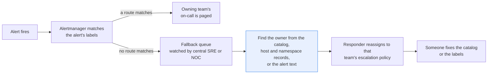
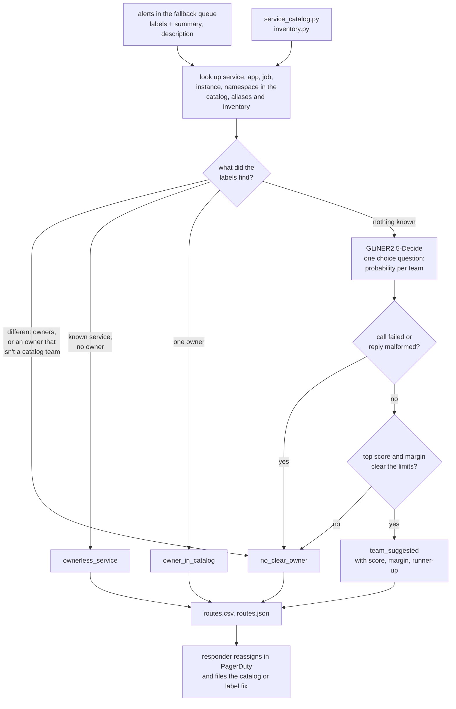

# Route alerts to the team that owns them

> **This example:** the central SRE responder working the fallback queue of alerts no routing rule
> matched.
>
> **How it works:** the service catalog and host inventory are checked first. Only when they name
> nobody does a classification model suggest a team from the alert text.
>
> **Use the same pattern for:** tickets in a shared ops queue, untagged cloud resources that need a
> cost owner, a failing scheduled job nobody claims.

## Background

Most alerts never need a person to work out who owns them. Alertmanager matches the alert's
labels against its routes, the route points at a PagerDuty service, and the owning team's
on-call gets the page. That only works when the alert carries a label a route knows. Anything
that doesn't match falls through to the catch-all route, which at most companies is a shared
fallback queue (a `sre-triage` service in PagerDuty, or a channel in Slack) watched by a central
SRE or NOC (network operations center) responder.

What that responder does with each fallen-through alert is a small investigation. The phone
buzzes, they open the incident in PagerDuty, read the labels and the summary, follow the
dashboard link if there is one, and then go looking for an owner: the service catalog
(Backstage or a YAML file in a repo), the Kubernetes namespace's owner annotation, the cloud
tags on the instance, the CMDB (configuration management database, the record of which hosts
exist and what runs on them). If they find one, they reassign the incident to that team's
escalation policy. If they don't, they read the alert text and make an educated guess, page
that team, and hope. Often at 3 a.m.

A lot of what they need is already structured. The alert's labels say which service, app, job,
namespace or instance fired. The catalog names an owner for each known service, with the other
names it shows up under. A host inventory or the namespace metadata says who runs an IP or a
namespace. None of that needs a model. The alerts that genuinely need reading are the rest: a
service nobody registered, a renamed one, a probe with no labels at all, where the only clue
is the alert name and its summary and description.

Why it matters: an alert sitting in the fallback queue is an outage nobody who can fix it knows
about yet. A wrong guess is worse than a slow one, because the paged team spends ten minutes
proving it isn't theirs while the clock runs. And every alert that reaches the fallback queue
is also a bug report against the routing config or the catalog, which nobody files at 3 a.m.

Here's the job end to end, and the step this recipe takes on:



## The problem

You want each alert in the fallback queue matched to an owner from the structured data first,
and, only when that comes up empty, a suggested team with the words it was based on. Then the
responder reassigns, and someone fixes the catalog or the labels so the next one routes itself.

The obvious shortcuts each fail. Exact label matching is what Alertmanager already did, and it's
why the alert is here: `app=Frontend` doesn't match a route for `service=web-frontend`. Sending
the whole alert to a classifier lets infrastructure words stand in for ownership. A stalled
Kafka consumer mentions Kafka, but the team that owns the consumer is usually the application
team, not the people who run the brokers. And a model's confidence is not evidence: a vague
"synthetic check failed" alert can score high for one team while naming no system at all.

So the recipe never reassigns anything. For each alert it reports what the checks found:

- **`owner_in_catalog`**: a label (or a host or namespace record) maps to a known service with
  an owner. The responder reassigns to that team; the catalog or the route needs the missing
  alias.
- **`ownerless_service`**: the catalog knows the service and records no owner. It stays in the
  fallback queue; whoever runs the catalog has to find it a home.
- **`team_suggested`**: nothing structured names an owner, and the model's top team clears the
  score and margin limits. It's a suggestion with the words it came from. The responder checks
  it before reassigning.
- **`no_clear_owner`**: labels that point at two different owners, a model split between two
  teams, or a reply that failed. The responder investigates from scratch.

None of these is a page. The responder in the fallback queue decides every reassignment in
PagerDuty, and the team that runs the catalog decides what to do about `ownerless_service`. The
recipe also doesn't do Alertmanager's job: it doesn't group, silence or deduplicate alerts, and
it only sees the ones that already fell through.

### Examples

Here are three of the alerts in `data/alerts.json`, and what should happen to each.

**1. A label the route didn't know (AL-02).**
- **Input:** `"app": "Frontend"`, "p99 page latency 4.1s over 10m (threshold 2s)".
- **What should happen:** the route wanted `service=web-frontend`, but the catalog lookup checks
  `app` too, ignores case and knows `Frontend` as an alias, so the model is never asked.
- **Expected outcome:** `owner_in_catalog`, storefront.

**2. Kafka in the text, but not a Kafka problem (AL-04).**
- **Input:** `"service": "loyalty-points"` (not in the catalog), the summary "Kafka consumer group
  loyalty-points is 85,000 messages behind on topic order-events" and the description "Consumer lag
  has grown for 20 minutes; partitions 3 and 7 have no active consumer."
- **What should happen:** nothing structured names an owner, so the model reads the text. The
  consumer is down, not the broker, so the owner should be loyalty, not the streaming team.
- **Expected outcome:** `team_suggested`, loyalty.

**3. A certificate that reads like two teams' (AL-05).**
- **Input:** `"namespace": "edge"` (not in the records), "TLS certificate for shop.larkspur.example
  expires in 6 days".
- **What should happen:** the namespace isn't in the records, and the model should split between
  platform and storefront closely enough to miss the margin limit.
- **Expected outcome:** `no_clear_owner`.

On the live run, 11 of 11 planted cases came out as expected; [What came out](#what-came-out) has
each one.

## How we'll solve it

1. **Start from what the alert and the records already say.** The input is the alerts as the
   fallback queue received them (labels plus `summary` and `description` annotations), the
   service catalog (teams with one-line descriptions, services with owners and aliases), and a
   host and namespace inventory that maps an `instance` or `namespace` to a service. The catalog
   and the inventory are two small lookup modules, `service_catalog.py` and `inventory.py`,
   standing in for the calls you'd make to Backstage and your CMDB.
2. **Look up every label that can name an owner, in Python.** Check all of `service`, `app`,
   `job`, `instance` and `namespace` against the catalog names, aliases and the inventory,
   ignoring case. An unknown label doesn't stop the search, so a known `app` label still counts
   when `service` names something new. If two labels name services with different owners, the
   alert is `no_clear_owner` with both shown. A known service with no owner is
   `ownerless_service`, and the model isn't asked.
3. **Ask the model only about the rest.** `fastino/GLiNER2.5-Decide` answers one choice question
   ("which team owns the system this alert is about?") with the catalog's teams and their
   descriptions as the options, and returns a probability for each. The catalog has a team for
   the application side too: the loyalty team owns the services that award points, and the
   streaming team runs the Kafka brokers, topics and partitions. That's how a stalled consumer
   and a sick broker can land on different teams.
4. **Check the answer in Python.** A top team below the score limit, or too close to the
   runner-up, is `no_clear_owner`, with both teams shown. Otherwise it's `team_suggested`,
   with the score, the margin and the runner-up. When the alert had no label to look up at all,
   the reason says so: the suggestion rests on the alert's text alone.
5. **Write one row per alert** with the status, the team, how it was found, the text the model
   read and the reason, so the responder can act on it and file the catalog fix.

If SIE refuses a call outright (a bad key, an unknown model, no credits), the run stops with
SIE's message and writes nothing; if a call fails for a reason that may pass (a timeout, a busy
server) or its reply is missing the expected fields, the alert in it comes out `no_clear_owner`
with the reason, the catalog rows are still written, and the run stops only if every call fails.

## Picking the model

There's one model, `fastino/GLiNER2.5-Decide`, called through SIE's `extract` with an
`output_schema` holding one `choice` question. It's a small encoder model (no generative model
makes the decision here) that answers a typed question about a text and gives a probability for
every option. That's the shape this job needs: the options are the catalog's teams, so adding a
team with a one-line description is all it takes for the next run to suggest it, with no
training and no prompt to maintain.

It has two habits worth knowing, both from our runs. It reads names more than it reads roles:
AL-04's `service: loyalty-points` pulls it to the loyalty team at 0.83, which is right, but the
same alert scored streaming highest before the catalog had a loyalty team. And it handles
negation badly. We first wrote the streaming team's description as "Kafka brokers, partitions
and replication, not the applications that consume from them", which is what we meant. With
those words in it, the broker alert (AL-11) scored 0.46 for streaming, under the 0.50 limit;
without them it scored 0.53 in the same test. So the description now says only what the team
runs, and the loyalty team's description carries the other half. The question, the
eight team descriptions and the alert all share the model's window of about 512 tokens, so keep
each description to one short line.

It is called once per alert that no record places, five of the eleven here. Everything else is a
lookup.

## The flow



## How it's built

Everything you'd want to change without reading Python is in [`rules.yaml`](./rules.yaml): the
model name, which labels can name an owner and where each is looked up (`owner_labels`), the
labels the model never reads (`hidden_labels`), the question, and the two limits
(`min_team_score` 0.50, `min_team_margin` 0.20). The teams and services are data, in
`data/catalog_teams.csv` and `data/catalog_services.csv`; the hosts and namespaces are in
`data/inventory_hosts.csv` and `data/inventory_namespaces.csv`. [`recipe.py`](./recipe.py) is
about 630 lines and reads top to bottom in the order of the flow.

| Step | Code | SIE call | What it does |
| --- | --- | --- | --- |
| Load | `load_alerts`, `parse_alerts` | none | Reads `data/alerts.json`; repeated alert ids are an error |
| Catalog | `ServiceCatalog` in `service_catalog.py`: `teams`, `find_service` | none | Loads the catalog CSVs into an in-memory SQLite database. A name or alias matches exactly, ignoring case and surrounding spaces; a name used by two services is an error |
| Inventory | `Inventory` in `inventory.py`: `find_host`, `find_namespace`, `host_part` | none | Same for the hosts and namespaces. The port is dropped from `address:port` (IPv6 in brackets too); a host matches by address or host name, exactly |
| Look up the labels | `label_values`, `look_up_labels` | none | Every label in `owner_labels`, every name in a label that holds several (`a,b`). Notes each one no record knows |
| Decide from records | `route_by_records` | none | One owner: `owner_in_catalog`. No owner: `ownerless_service`. Two owners (an owned and an ownerless service included), or an owner that isn't a catalog team: `no_clear_owner`. Nothing placed: on to the model |
| Ask the model | `alert_text`, `team_schema`, `ask_team`, `read_probabilities` | `extract` | One call per alert: the alert name split into words, the summary and description, and the labels not in `hidden_labels`. The reply must give a probability from 0 to 1 for exactly the catalog's teams; anything else is a failed call |
| Check the answer | `route_by_model`, `why_model_asked` | none | Score under 0.50 or margin under 0.20: `no_clear_owner`. Otherwise `team_suggested`, with the runner-up and "check it before reassigning" |
| Write | `write_outputs`, `csv_safe` | none | `routes.csv` and `routes.json`. A CSV cell that starts like a spreadsheet formula gets a leading `'` |

The SIE error rule is the same as in the security recipes (`SIEStopped`, `is_fatal`,
`CallLog`, `guarded`). A call that fails for a reason that may pass (a timeout, a lost
connection, a 5xx, a rate limit, a model still loading, an alert too long for the window, or a
reply without the probabilities) makes that alert `no_clear_owner` with a short reason, and the
run carries on. A refusal every call would repeat (a bad key, no credits, a model name SIE
doesn't know) stops the run with SIE's full message and writes no outputs. If every model call
failed, the run stops too, even with catalog rows ready, since half an answer looks like a whole
one at 3 a.m.

[`selfcheck.py`](./selfcheck.py) checks the lookups and their near misses (`checkout` is not
`checkout-ui`, `10.0.4.170` is not `10.0.4.17`), every records rule, the score and margin
limits, the reply checks, the SIE error rule, the four statuses and the CSV escaping, offline,
with hand-written alerts and stand-in model replies.

## Run it

You need [uv](https://docs.astral.sh/uv/) and an SIE API key
([create one](https://console.superlinked.com/console/api-keys?utm_source=github&utm_medium=docs&utm_campaign=sie-cookbook&utm_content=sre-route-alerts-to-owners)).

```bash
cp .env.example .env   # then set SIE_API_KEY
uv run recipe.py
uv run selfcheck.py    # optional: offline checks, no SIE call
```

`uv run` installs this recipe's few dependencies into its own `.venv` on the first run. Each run
writes `runs/<timestamp>/`; `--output DIR` changes that. The first call can wait a few minutes
while SIE Cloud starts the GLiNER2.5-Decide model. A warm run makes 5 SIE calls, one per alert
the records can't place, and takes about 2 seconds.

## What came out

### The three examples

- **AL-02:** `owner_in_catalog`, storefront. As expected.
- **AL-04:** `team_suggested`, loyalty at 0.83, streaming the runner-up at 0.15. As expected.
- **AL-05:** `no_clear_owner`, platform 0.54 vs storefront 0.38, margin 0.16 under 0.20 (the row is
  quoted below). As expected.

### Every planted case

On the live run on 4 Nov 2026, 11 of 11 planted cases came out as expected.

The input is [`data/alerts.json`](./data/alerts.json): 11 alerts shaped like the alerts in an
Alertmanager webhook (labels plus `summary` and `description`), the ones no route matched. The
catalog has 8 teams and 13 services (one with no owner); the inventory has 8 hosts and 6
namespaces.

The catalog, the inventory, the alerts and the shop (Larkspur Supply) are synthetic, written for
this recipe.

| Case | What we planted | Came out | Why |
| --- | --- | --- | --- |
| AL-01 | `service=payments-api` | `owner_in_catalog`: payments | The plain case: the label is in the catalog |
| AL-02 | `app=Frontend`: another label key, an alias, different case | `owner_in_catalog`: storefront | Why it fell through: the route wanted `service=web-frontend` |
| AL-03 | No service label, Postgres replication lag, `instance=10.0.4.17:9187` | `owner_in_catalog`: data-platform, from the inventory | The instance is `pg-orders-2`, a host of `orders-db`; no model needed |
| AL-04 | Unknown `service=loyalty-points`, consumer lag, partitions with no active consumer | `team_suggested`: loyalty 0.83, streaming the runner-up at 0.15 | Near miss: the consumer is down, not the broker, so "Kafka" in the text is not the owner |
| AL-05 | No service label, TLS certificate on the shop hostname, `namespace=edge` (not in the records) | `no_clear_owner`: platform 0.54 vs storefront 0.38 | The hostname reads like both; margin 0.16 is under 0.20 |
| AL-06 | No service label, vague synthetic-check failure | `team_suggested`: storefront 0.57, with "the alert names no system" in the reason | Confidence isn't evidence; the reason tells the responder there was nothing to look up |
| AL-07 | Text sounds like a database disk alert, label says `search-es` | `owner_in_catalog`: search | Near miss: the label wins over the words |
| AL-08 | Known service `legacy-reports` with no owner | `ownerless_service` | The catalog knows nobody owns it; the model isn't asked |
| AL-09 | Unknown `service=auth-v2`, OAuth login failures | `team_suggested`: identity 0.88 | A renamed service the text identifies clearly |
| AL-10 | `service=checkout-v3` (unknown) and `app=checkout-ui` (known) | `owner_in_catalog`: storefront, from `app` | Near miss: an unknown first label must not hide a known second one |
| AL-11 | No service label, Kafka broker with under-replicated partitions, `instance` of a host not in the inventory | `team_suggested`: streaming 0.56, margin 0.37 | The other half of AL-04: a broker problem really is the streaming team's |

The run gave 5 `owner_in_catalog`, 1 `ownerless_service`, 4 `team_suggested` and 1 `no_clear_owner`,
with the limits as first written. Two warm runs gave the same scores. Treat this as a demo that the
wiring works, not as a measure of accuracy: eleven alerts tell you the rules fire, not how often the
model's suggestion is the right team.

A few things worth noticing:

- **Six of eleven never reach the model.** AL-02 and AL-10 are the classic reasons an alert
  falls through: a label key the route doesn't use, a case difference, a new build name next to
  an old one. AL-03 has no service label at all, but its `instance` is a host the inventory
  knows. Most of those rows are also a fix to file: add the alias, or route on `app` too.
- **AL-06 is a confident guess about nothing.** Storefront at 0.57 with a margin of 0.47 clears
  both limits, so it's `team_suggested`. Raising the limits wouldn't make the alert say more.
  What the recipe can do is say plainly that no label named anything, and it does. Here's the
  row from `routes.csv`, trimmed to the useful columns:

  ```text
  alert_id,status,team,score,runner_up,margin,reason
  AL-06,team_suggested,storefront,0.571,loyalty,0.467,"no service, app, job, instance or namespace label: the alert names no system, so this rests on its text alone; model suggests storefront at 0.57, margin 0.47 over loyalty; check it before reassigning"
  ```

  The runner-up is the loyalty team, which has about as much to do with a failed smoke test as
  anyone else. That's the model telling you it's guessing.
- **AL-04 and AL-11 are the same words with different owners.** Both are Kafka alerts about
  partitions that aren't being served. The consumer alert goes to loyalty because the
  alert names `loyalty-points` and the catalog has a team that owns loyalty services; the broker
  alert goes to streaming. AL-11 is the closer of the two: 0.56 against a limit of 0.50.
- **AL-05 stays with the responder.** Platform 0.54, storefront 0.38. A certificate on the shop
  hostname, renewed by cert-manager on the ingress, really is a bit of both, and a split is the
  honest answer:

  ```json
  {"alert_id": "AL-05", "status": "no_clear_owner", "team": "", "suggested_team": "platform",
   "score": "0.538", "runner_up": "storefront", "runner_up_score": "0.376", "margin": "0.162",
   "reason": "namespace=edge is not in the namespace records; model split: platform 0.54 vs storefront 0.38, margin 0.16 under 0.20"}
  ```

  The fix here isn't a better model, it's adding `edge` to the namespace records.

### What you do next

The responder on the fallback queue reads `routes.csv`. An `owner_in_catalog` row gets reassigned to
that team's escalation policy in PagerDuty; a `team_suggested` row gets checked against its reason
first; a `no_clear_owner` row they investigate from scratch. Then the fixes get filed so the next
alert routes itself: the missing alias or a route on `app`, `edge` in the namespace records, and
`legacy-reports` to whoever runs the catalog to find it an owner.

## Potential improvements

- **Your own catalog and inventory.** Replace the bodies of `ServiceCatalog` and `Inventory`
  with calls to your Backstage, CMDB or Kubernetes API, and keep the function names. The team
  descriptions share GLiNER2.5-Decide's window of about 512 tokens with the question and the
  alert, so keep each to one line.
- **Which labels count.** `owner_labels` lists the labels that can name an owner and where each
  is looked up; `hidden_labels` lists the labels the model never reads. A `job` label often
  names an exporter (`node-exporter`) rather than the service, which is harmless while no
  exporter is in the catalog.
- **Check the limits on your own alerts.** `min_team_score` and `min_team_margin` are starting
  points. They can't fix an alert like AL-06 that names nothing; for those, the better fix is a
  label on the alert rule.
- **Close the loop.** Every `owner_in_catalog` row is a missing alias or route, and every
  `team_suggested` row the responder confirms is a catalog entry nobody wrote. A small step that
  turns confirmed rows into catalog changes would empty the fallback queue over time.
- **Consumer groups as records.** Kafka knows which consumer group belongs to which application.
  A lookup from consumer group to service would settle AL-04 without the model.
- **Batch the calls.** The recipe makes one call per alert, so a failure only touches that alert.
  A busy queue would want several alerts per call, at the cost of losing them together.

## Try another model

The model is one line under `models:` in `rules.yaml`. On 4 Nov 2026 (UTC) we tried
`fastino/gliner2-large-v1`, the other GLiNER2 model on SIE Cloud, with nothing else changed. SIE
refused the first call with HTTP 400 (`INVALID_INPUT`: "GLiNER2 output_schema root type must be
object"), so the run stopped with that message and wrote nothing, which is the refusal rule
doing its job. It takes a different schema shape, so it isn't a drop-in swap, and
GLiNER2.5-Decide is the only model on SIE Cloud that answers this choice question as written.
See [MODELS.md](../../MODELS.md) for every model these recipes use and for models you can
self-host.

## Run it on your own SIE

The same code runs against an SIE server you host. Set `SIE_BASE_URL` in `.env`; an API key
is then optional. The table gives the SIE v0.10.1 image each model runs on, from SIE's
[compatibility matrix](https://github.com/superlinked/sie/blob/main/docs/compatibility.md).

| `rules.yaml` key | Model | Image | Tested on |
| --- | --- | --- | --- |
| `team` | `fastino/GLiNER2.5-Decide` | `cuda12-transformers5` | L4 |

One container serves it:

```bash
docker run --gpus all -p 8080:8080 -v sie-hf-cache:/app/.cache/huggingface \
  ghcr.io/superlinked/sie-server:v0.10.1-cuda12-transformers5
# then set SIE_BASE_URL=http://localhost:8080 in .env and run: uv run recipe.py
```

## Files

- `recipe.py`: the pipeline
- `service_catalog.py`: lookups in the service catalog, over `data/catalog_teams.csv` and
  `data/catalog_services.csv`
- `inventory.py`: lookups in the host and namespace inventory, over `data/inventory_hosts.csv`
  and `data/inventory_namespaces.csv`
- `selfcheck.py`: plain asserts on the lookups, the ownership rules, the model checks and the SIE
  failure rule, no SIE call (`uv run selfcheck.py`)
- `rules.yaml`: model ID, owner labels, hidden labels, question, limits
- `data/alerts.json`: the 11 planted alerts
- `pyproject.toml`, `uv.lock`: this recipe's dependencies

See the SIE [classify](https://superlinked.com/classify?utm_source=github&utm_medium=docs&utm_campaign=sie-cookbook&utm_content=sre-route-alerts-to-owners) task page.
