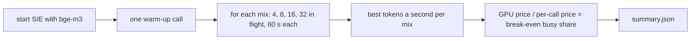

# Find when renting a GPU beats paying per call

> **This example:** `BAAI/bge-m3`, a popular embedding model, on one NVIDIA L4 through one SIE server:
> how many input tokens a second it embeds on short queries, long passages and a mix of the two, and
> how busy that L4 has to be before renting it all month costs less than paying per call.
>
> **How it works:** the recipe keeps 4, 8, 16 and 32 requests of 8 texts in flight for a minute each,
> counts the tokens SIE reports for every response, and divides the GPU's monthly price by the
> per-call price to get the break-even.
>
> **Use the same pattern for:** any model you're thinking of moving off a per-call price onto a GPU of
> your own. Change the model, the GPU price and the per-call price in `rules.yaml`.

## Background

Somebody on your team has found an embedding model that does the job, and the next question is the
one your manager asks: what will it cost to run? There are two ways to pay. You can rent a GPU and
keep it on, which is a fixed bill whether you use it or not, or you can pay for what each call uses,
which costs nothing in the quiet hours. Which one is cheaper depends on one number most teams guess:
how busy that GPU would really be.

## The problem

The rent is easy: an L4 at a typical on-demand price of $0.80 an hour is $584 a month. The hard part
is the other side of the sum, how many tokens that L4 embeds in a second, because it depends on your
inputs and on how many requests you keep in flight. A model card doesn't tell you. Built by hand,
you'd set up the server, write a load script, and still have to decide which number to trust.

### Examples

The queries and passages come from NFCorpus (BeIR/nfcorpus, CC BY-SA 4.0, revision `b5026a0e`): all
3,237 queries and the first 1,000 passages, in `data/`; `fetch_data.py` rebuilds them. Each mix is a
fixed list of 4,000 texts drawn from them with a fixed seed.

1. **Short queries only.** Search-box traffic, a few words each. Throughput should be under half of
   the long mix's, because each request carries little work.
2. **Long passages only.** Indexing traffic. The GPU should be nearly saturated: every level of
   requests in flight within 10% of the best one.
3. **70% queries, 30% passages.** A search system that indexes and answers at the same time. This is
   the mix the break-even uses. Our earlier estimate of 37,000 to 49,000 tokens a second put the
   break-even at 12 to 16% busy.

These three expectations are in `rules.yaml` under `expect`, and each run prints Pass or Miss for
each one and writes them to `summary.json`.

## How we'll solve it

For each mix and each number of requests in flight, the recipe sends `encode` calls of 8 texts for
60 seconds, ignores the first 15, and adds up the input tokens SIE reports in each response's usage.
It samples the GPU's busy share once a second with `nvidia-smi`. It counts errors and responses
without a usage block in the same window; a cell where they add up to more than 1% of its requests
(`max_bad_share`) is left out. The best of the other cells per mix is that mix's throughput.

The break-even is arithmetic. $584 a month buys 15.5 billion bge-m3 tokens at SIE Serverless's list
price ($0.0377 per million input tokens, effective 13 October 2026). Spread over a month, that's about
5,900 tokens a second around the clock. Divide by the measured throughput, and you have the share of
the time the L4 must be busy before renting it costs less.

## Picking the models

- **`BAAI/bge-m3`**: a widely used multilingual embedding model, small enough for one L4, and one SIE
  Serverless prices per token, so the two sides of the sum use the same unit.

## The flow



## How it's built

All of it is Python and `rules.yaml`: the image, the model, the mixes, the load and both prices.

| Step | Function | What it does |
| --- | --- | --- |
| Build the inputs | `build_mix` | A fixed, shuffled list of queries and passages per mix |
| Start SIE | `start_server`, `wait_ready` | `docker run` of the SIE image (or the same command as a process), then one call to load the model |
| Measure | `measure_cell`, `input_tokens` | Keeps the requests in flight and records each one's tokens, latency or error |
| Sum up a cell | `summarize_cell` | Tokens a second, p50, errors, responses without usage and GPU busy share after the warm-up |
| Break-even | `break_even`, `best` | Monthly GPU price over per-call price, as a share of the best cell's throughput |
| Verdicts | `verdicts` | Pass or Miss for each expectation under `expect` in `rules.yaml` |

## Run it

**Run this recipe using [SIE Serverless](https://superlinked.com/serverless?utm_source=github&utm_medium=docs&utm_campaign=sie-cookbook&utm_content=why-sie-find-when-a-gpu-pays-off), [SIE Cluster](https://superlinked.com/docs/deployment?utm_source=github&utm_medium=docs&utm_campaign=sie-cookbook&utm_content=why-sie-find-when-a-gpu-pays-off) or [SIE Local](https://superlinked.com/docs/quickstart?utm_source=github&utm_medium=docs&utm_campaign=sie-cookbook&utm_content=why-sie-find-when-a-gpu-pays-off).** This one measures a GPU you run yourself, so it needs SIE Local on that GPU; the SIE Serverless side of the comparison is its list price, which is in `rules.yaml`. To pay per call instead, get an [SIE API key](https://console.superlinked.com/console/keys?utm_source=github&utm_medium=docs&utm_campaign=sie-cookbook&utm_content=why-sie-find-when-a-gpu-pays-off) and read the [API docs](https://superlinked.com/docs/reference/api?utm_source=github&utm_medium=docs&utm_campaign=sie-cookbook&utm_content=why-sie-find-when-a-gpu-pays-off). To run the models yourself, start from the [SIE repo](https://github.com/superlinked/sie).

You need [uv](https://docs.astral.sh/uv/), Docker with the NVIDIA container toolkit, and one GPU
with nothing else on it. Run it on that machine:

```bash
docker pull ghcr.io/superlinked/sie-server:v0.11.1-cuda12-default
uv run recipe.py            # about 15 minutes
uv run selfcheck.py         # optional: offline checks, no GPU
```

`--launcher process` starts the same server command without Docker. It needs the interpreter of an
environment with SIE installed, passed as `--server-python /path/to/sie-env/bin/python`, because
`uv run` puts this recipe's own environment first and that one has only the SDK. Pass
`--models-dir` if your models directory isn't the default. `--launcher none --url URL` measures a
server that's already running. The recipe gives the server only the GPU at `gpu_index` in
`rules.yaml` and samples that GPU; with `--launcher none`, start your server on that GPU. Each run
writes `runs/<timestamp>/summary.json`, and with `docker` or `process` also the server log
(`--launcher none` writes no server log); `--output DIR` changes the folder. Change
`gpu_price_per_hour` in `rules.yaml` to your own price.

## What came out

We ran it on 16 Nov 2026 at 03:43 UTC on one NVIDIA L4, with `--launcher process` in an environment
built from SIE v0.11.1's source (the same code as the published `cuda12-default` image).

### The three examples

**1. Short queries only.**
- **Expected outcome:** under half of the long mix's best.
- **What came back:** at most 17,915 tokens a second (16 in flight), with the GPU only 26 to 29% busy
  past 4 in flight. At these prices the L4 pays off above 33% busy.
- **Verdict:** Pass.

**2. Long passages only.**
- **Expected outcome:** the GPU nearly saturated, every level within 10% of the best.
- **What came back:** 52,286 to 53,754 tokens a second at every level, with the GPU 87 to 89% busy.
  Four requests in flight already fill it.
- **Verdict:** Pass.

**3. 70% queries, 30% passages.**
- **Expected outcome:** the L4 pays off somewhere around 12 to 16% busy.
- **What came back:** 49,420 to 51,568 tokens a second (best at 32 in flight), the GPU 81 to 83% busy.
  5,901 tokens a second around the clock costs the same as the L4, so it pays off above 11.4% busy.
- **Verdict:** Miss. In the reader's favour: the L4 is faster than we estimated, so it pays off
  sooner.

### Results

2 of 3 mixes came out as expected, with 0 errors in 55,080 requests.

| Mix | 4 in flight | 8 | 16 | 32 | Renting pays off above |
| --- | --- | --- | --- | --- | --- |
| Short | 10,340 | 17,123 | 17,915 | 16,114 | 33% busy |
| Long | 52,921 | 52,286 | 53,474 | 53,754 | 11% busy |
| Mixed | 50,608 | 50,456 | 49,420 | 51,568 | 11% busy |

Tokens a second, one 60-second cell each. In an earlier, longer run of the same setup (three runs of
150-second cells) we measured 52,608 tokens a second on the mix, 55,661 on long passages and 19,686
on short queries, so a one-minute cell lands within about 2 to 9% of a longer one.

**Where it works:** traffic with real passages in it. A rented L4 that's busy more than about one
hour in nine costs less than paying per call for bge-m3, and on indexing work it stays nearly fully
used.

**Where it fails:** short queries alone. The GPU sits mostly idle while the per-request work (HTTP,
tokenizing, batching) sets the pace, so the same L4 does a third of the work and needs to be busy a
third of the time to pay off. And the break-even counts only the GPU: a real deployment adds CPU,
memory, a second GPU for redundancy and someone to run it, all of which push the line higher.

### What you do next

Put your own GPU price and per-call price in `rules.yaml`, run it with inputs that look like yours,
and compare the break-even with how busy you expect the GPU to be. A nightly re-index of 50 million
tokens is about 1.5 billion tokens a month, about 1% of what the L4 can embed on this mix: pay per
call. Steady traffic of more than about 6,000 tokens a second, around the clock: rent the GPU.

## Potential improvements

- Run each cell longer and three times, and report the median, the way the earlier run did.
- Add the CPU and memory you'd rent with the GPU to the monthly price.

## Try another model

The model and both prices are in `rules.yaml`. Any model SIE can `encode` works, as long as you also
change the per-call price to that model's. We haven't run another model yet. See
[MODELS.md](../../MODELS.md) for the models these recipes use.

## Run it using SIE Cluster or SIE Local

This recipe runs SIE itself on the machine with the GPU. The table gives the SIE image the model runs
on, from SIE's [compatibility matrix](https://github.com/superlinked/sie/blob/main/docs/compatibility.md).

| `rules.yaml` key | Model | Image | Tested on |
| --- | --- | --- | --- |
| `model` | `BAAI/bge-m3` | `cuda12-default` | L4 |

```bash
docker run --gpus all -p 8080:8080 -v sie-hf-cache:/app/.cache/huggingface \
  ghcr.io/superlinked/sie-server:v0.11.1-cuda12-default
# then run: uv run recipe.py --launcher none --url http://localhost:8080
```

## Files

- `recipe.py`: starts the server, drives the load and works out the break-even
- `selfcheck.py`: plain asserts on the mixes, the per-cell sums, the break-even arithmetic and the verdicts, no GPU (`uv run selfcheck.py`)
- `rules.yaml`: image, model, GPU, mixes, load, GPU price, per-call price and the expected outcomes
- `fetch_data.py`, `data/queries.json`, `data/passages.json`: the inputs
- `pyproject.toml`, `uv.lock`: this recipe's dependencies
