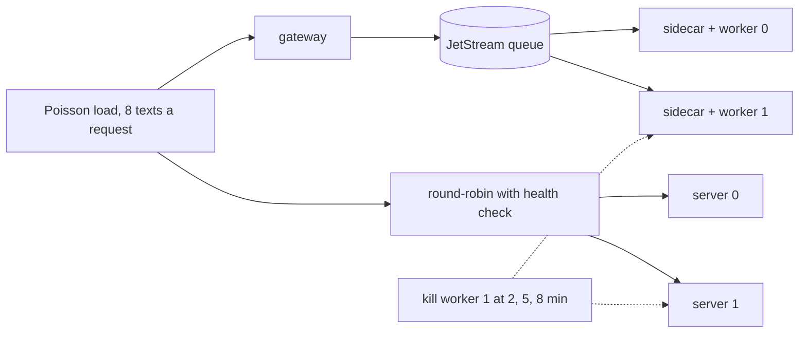

# Kill a GPU worker under load, behind SIE's queue and behind a round-robin

> **This example:** two GPU workers serving the embedding model bge-m3 at a steady 64 requests a
> second, while one of them is killed and started again three times. Once behind SIE's queue (its
> gateway, a NATS JetStream queue and a sidecar per worker), once behind a round-robin with a health
> check, the way you'd put two servers behind a proxy yourself.
>
> **How it works:** the recipe starts each setup from the published SIE images, finds how many
> requests a second each one handles, then kills worker 1 with `SIGKILL` at minutes 2, 5 and 8 and
> counts every request that failed or came back slow. Last, it kills an SGLang model's engine process
> twice and times how long SIE takes to answer again.
>
> **Use the same pattern for:** deciding whether the requests in flight on a dying worker matter to
> you, before you pick between a load balancer and a queue.

## Background

GPU workers die. A node gets reclaimed, a driver falls over, a container runs out of memory, an
engine crashes on an input nobody tested. With one model on one server you notice and restart it.
With several workers serving an agent's models, the question is what happens to the requests that
were on the dead worker when it died, and to the ones that keep arriving while it comes back.

## The problem

The setup you'd build yourself is one server per GPU behind a load balancer that sends requests to
each in turn and skips a server for a while after a connection error (nginx calls this
`fail_timeout`). It's simple and it's fast. But a request that's already on a server when it dies is
lost: the caller gets a connection error and has to retry it, if it retries at all.

SIE's queue works the other way round. The gateway puts each request on a NATS JetStream queue,
and each worker's sidecar pulls requests and confirms them when they're done. If a worker dies before
confirming, its requests go back on the queue after 30 seconds and another worker picks them up. The
price is an extra hop and, after a kill, a backlog that waits for the restarted worker.

### Examples

The inputs are 2,000 texts, 70% NFCorpus queries and 30% NFCorpus passages (BeIR/nfcorpus,
CC BY-SA 4.0, revision `b5026a0e`), in `data/texts.json`; `fetch_data.py` rebuilds them. Each
request carries 8 of them. The 15 chat messages in `data/prompts.json` are synthetic.

1. **How much each setup handles.** Both at 40, 50, 55, 60 and 65 requests a second per GPU, a
   minute each. The queue should handle at least as many as round-robin, with p95 under 500 ms.
2. **Killing a worker.** 64 requests a second for 10 minutes; worker 1 killed at 2, 5 and 8 minutes
   and started again 5 seconds later. The queue should lose no request.
3. **Killing an engine.** One SIE server with the SGLang guard model `Qwen/Qwen3Guard-Gen-0.6B` at 4
   requests a second; its SGLang process killed at 2 and 5 minutes. SIE should answer again within 2
   minutes, and requests in between should fail fast instead of hanging.

## How we'll solve it

The recipe starts every piece itself: NATS, the gateway and one server plus sidecar per GPU for the
queue, and one server per GPU for round-robin. The round-robin is about 30 lines in `recipe.py`
(`Targets`): it sends each request to the next server and skips a server for 10 seconds after a
connection error, which is what a proxy's passive health check does. Requests arrive at random
intervals (Poisson), so they don't wait for each other's answers, the way traffic from many users
arrives.

## Picking the models

- **`BAAI/bge-m3`** for the worker kills: a popular embedding model, small enough that a worker
  restarts in seconds, so the test is about the requests and not about loading.
- **`Qwen/Qwen3Guard-Gen-0.6B`** for the engine kill: it runs on SGLang, which SIE starts as a child
  process, so killing that process is an engine crash SIE has to notice and recover from.

## The flow



## How it's built

Everything is Python and `rules.yaml`. The model and bundle configs in `config/` are SIE v0.11.1's
own, copied unchanged.

| Step | Function | What it does |
| --- | --- | --- |
| Start a piece | `Launcher.start` | `docker run` of its image, or the same command as a process |
| Start a setup | `Stack.up`, `Stack.start_worker` | NATS, workers, sidecars and gateway; or one server per GPU |
| Capacity | `capacity`, `capacity_from` | Stepped rates; the highest step with p95 under 500 ms and no errors |
| Worker kills | `kill_test`, `Stack.kill_worker`, `summarize_kill` | Steady load while worker 1 is killed and restarted |
| Engine kill | `engine_test`, `engine_recoveries` | Kills the SGLang process; times until a request is answered again |
| Round-robin | `Targets` | Next server in turn, skipping one for 10 s after a connection error |

## Run it

**Run this recipe using [SIE Serverless](https://superlinked.com/serverless?utm_source=github&utm_medium=docs&utm_campaign=sie-cookbook&utm_content=why-sie-kill-a-worker-under-load), [SIE Cluster](https://superlinked.com/docs/deployment?utm_source=github&utm_medium=docs&utm_campaign=sie-cookbook&utm_content=why-sie-kill-a-worker-under-load) or [SIE Local](https://superlinked.com/docs/quickstart?utm_source=github&utm_medium=docs&utm_campaign=sie-cookbook&utm_content=why-sie-kill-a-worker-under-load).** This one is an exception: it kills workers, so it needs SIE Local on GPUs you control, and SIE Serverless runs the workers for you. For SIE Serverless, get an [SIE API key](https://console.superlinked.com/console/keys?utm_source=github&utm_medium=docs&utm_campaign=sie-cookbook&utm_content=why-sie-kill-a-worker-under-load) and read the [API docs](https://superlinked.com/docs/reference/api?utm_source=github&utm_medium=docs&utm_campaign=sie-cookbook&utm_content=why-sie-kill-a-worker-under-load). To run the models yourself, start from the [SIE repo](https://github.com/superlinked/sie).

You need [uv](https://docs.astral.sh/uv/), Docker with the NVIDIA container toolkit, and two 24 GB
GPUs (we used two A10s) with nothing else on them. Run it on that machine:

```bash
for i in sie-server:v0.11.1-cuda12-default sie-server:v0.11.1-cuda12-sglang \
         sie-server-sidecar:v0.11.1 sie-gateway:v0.11.1; do docker pull ghcr.io/superlinked/$i; done
docker pull nats:2.12-alpine
uv run recipe.py                        # capacity, worker kills and engine kill, about 50 minutes
uv run recipe.py --steps kill           # just the worker kills
uv run selfcheck.py                     # optional: offline checks, no GPU
```

`--launcher process` starts the same commands without Docker, for a machine with SIE's Python
environment, `nats-server`, and the `sie-gateway` and `sie-server-sidecar` binaries in `--bin-dir`.
Each run writes `runs/<timestamp>/summary.json`, every request of the kill test
(`kill-queue.jsonl`, `kill-round_robin.jsonl`) and every piece's log; `--output DIR` changes that.

## What came out

We ran it on 16 Nov 2026 at 05:03 UTC on two NVIDIA A10s, with `--launcher process` in a container
built from SIE v0.11.1's source, the same code as the published images. The Docker launcher runs the
same commands in those images; we didn't use it for this run.

### The three examples

**1. How much each setup handles.**
- **Expected outcome:** the queue handles at least as many requests a second per GPU, p95 under 500 ms.
- **What came back:** round-robin held the target at every step up to 65 a second per GPU (p95
  430 ms); the queue held it up to 60 (p95 298 ms) and missed at 65 (p95 2.8 s). Below that, round-robin
  was also faster: p50 25 ms against 39 ms at 40 a second per GPU. No errors in either.
- **Verdict:** Miss.

**2. Killing a worker.**
- **Expected outcome:** the queue loses no request.
- **What came back:** of 38,440 requests each, the queue answered all 38,440. Round-robin failed 26,
  all `Connection reset by peer` from the killed server at the moment of a kill. The queue paid in
  latency: after each kill, 1,182 to 1,347 requests took over 5 seconds while the restarted worker
  loaded bge-m3, and 24 took about 30 seconds (the ones the dead worker had taken, redelivered after
  the 30-second wait). Round-robin had 92 to 151 slow requests per kill.
- **Verdict:** Pass.

**3. Killing an engine.**
- **Expected outcome:** answering again within 2 minutes; requests in between fail fast.
- **What came back:** SIE logged `engine process exited with code -9 after load` at once, unloaded
  the model and reloaded it on the next request after its cooldown. After the first kill it answered
  again 31 seconds later, after the second 61 seconds later (the cooldown doubles with each crash in a
  row). In between, 124 and 248 requests failed, each within 123 ms, with `generation child is
  unavailable`.
- **Verdict:** Pass.

### Results

2 of 3 examples came out as expected.

| | Queue (gateway + JetStream) | Round-robin (2 servers, 10 s skip) |
| --- | --- | --- |
| Capacity, p95 under 500 ms | 60 requests a second per GPU | 65 or more |
| p50 at 40 a second per GPU | 39 ms | 25 ms |
| Kill test: sent / answered | 38,440 / 38,440 | 38,440 / 38,414 |
| Failed | 0 | 26 (`Connection reset by peer`) |
| Over 5 s | 3,737 | 338 |
| Slowest | 30.3 s | 63.0 s |
| p50 / p99 | 38 ms / 13.8 s | 25 ms / 4.9 s |

These match our earlier, longer runs on the same hardware: four A10s gave the queue 0.92 of
round-robin's capacity, and in 30 minutes with five kills the queue lost 0 of 115,337 requests
against round-robin's 42.

**Where it works:** keeping every request. When a worker dies, the queue gives its requests to
another worker, and nobody has to write retry logic for the ones in flight. Engine crashes are
handled too: SIE notices, fails requests fast instead of letting them hang, and reloads after a
cooldown that grows if the crashes keep coming.

**Where it fails:** throughput and latency. With one model and requests that are all the same size,
round-robin already spreads the work evenly, so the queue's extra hop costs about 13 ms at the median
and at least 8% of capacity. After a kill, the queue's backlog waits for the restarted worker: more than
ten times as many requests took over 5 seconds as with round-robin. If your callers retry on a
connection error anyway, round-robin is faster and simpler.

### What you do next

Ask what a lost request costs you. If a failed embedding call means one search box shows an error and
the user tries again, a load balancer is fine. If it means a document silently missing from an
index, or a step of a long agent run failing, the queue's 30-second redelivery is worth its latency.
Then run this recipe with your model and your request rate, and look at the "over 5 s" line before
you decide.

## Potential improvements

- Run each part three times and report the median; one run is what this README shows.
- Add a client that retries connection errors, to see how much of the queue's advantage that wins
  back for round-robin.

## Try another model

The model is one line in `rules.yaml`, with its config in `config/models/`. Any model the
`cuda12-default` image serves works for the worker kills; the engine kill needs a model SIE runs on
SGLang. We haven't run other models in this recipe.

## Run it using SIE Cluster or SIE Local

This recipe already runs SIE itself, on the machine with the GPUs. The table gives the SIE image each
model runs on, from SIE's
[compatibility matrix](https://github.com/superlinked/sie/blob/main/docs/compatibility.md).

| `rules.yaml` key | Model | Image | Tested on |
| --- | --- | --- | --- |
| `model` | `BAAI/bge-m3` | `cuda12-default` | A10 |
| `engine.model` | `Qwen/Qwen3Guard-Gen-0.6B` | `cuda12-sglang` | A10 |

The queue setup also uses `ghcr.io/superlinked/sie-gateway:v0.11.1`,
`ghcr.io/superlinked/sie-server-sidecar:v0.11.1` and `nats:2.12-alpine`. On Kubernetes, SIE's Helm
chart (`deploy/helm/sie-cluster` in the SIE repo) runs the same pieces.

## Files

- `recipe.py`: starts the setups, drives the load, kills workers and the engine, writes the summary
- `selfcheck.py`: plain asserts on the summaries and verdicts, no GPU (`uv run selfcheck.py`)
- `rules.yaml`: images, models, GPUs, rates, kill times and the expected outcomes
- `config/`: SIE v0.11.1's configs for the two models and their bundles, unchanged
- `fetch_data.py`, `data/texts.json`, `data/prompts.json`: the inputs
- `pyproject.toml`, `uv.lock`: this recipe's dependencies
