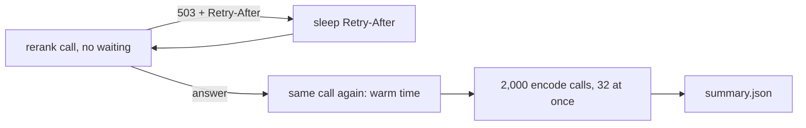

# Measure what a request sees when its model is cold, and how a burst comes back

> **This example:** a reranker that nobody has called for a while, called once, then again, and then
> 2,000 embedding calls from 32 callers at once, all against SIE Serverless.
>
> **How it works:** the recipe asks for the rerank without waiting, so each `503` the gateway answers
> while the model starts comes back to the code, with its `Retry-After`. It waits as long as that says,
> asks again until the answer comes, and times every step.
>
> **Use the same pattern for:** checking any model you depend on before you put it on the path of a
> user: how long its first call takes after a quiet night, and what your client sees meanwhile.

## Background

Your team's AI workloads don't run at a steady rate. A batch job re-indexes the document store at
2 a.m., an analyst team uses the extraction model from nine to five, and for the rest of the day the
GPUs sit there. You either keep them on and pay for the idle hours, or scale them to zero and make
the first user of the morning wait while everything starts again.

Built by hand, that start is slow. In May 2026 we measured it on our own Kubernetes cluster on AWS
(EKS, L4 GPUs): starting a model on a new GPU node took 5.2 to 9.0 minutes, and pulling the
container image alone was 46 to 72% of that. On a node that was already up, it still took 22 seconds
to 1.4 minutes, mostly downloading weights.

## The problem

SIE Serverless lets a model nobody is calling scale to zero, and you pay for what each call uses, so
the idle hours aren't on your bill. The question moves from "how fast does my cluster start" to "what
happens to the one request that arrives while the model is at zero, and to the burst that follows".
A cold-start number on a slide doesn't answer that for your models. Running the calls does.

### Examples

The data is synthetic: 20 short passages written for this recipe, in `data/passages.json`.

1. **The first call to a cold reranker.** One `score` call to `Qwen/Qwen3-VL-Reranker-2B`: the query
   "What lowers blood pressure?" against the first five passages. It should be answered within 300
   seconds. Any `503` before that should carry a `Retry-After`.
2. **The same call again.** It should come back within 2 seconds, now the model is running.
3. **A burst on bge-m3.** 2,000 single-passage `encode` calls to `BAAI/bge-m3`, 32 in flight at once.
   None should fail, and 95% should come back within 3 seconds.

## How we'll solve it

The recipe calls the model with `wait_for_capacity=False`. The SDK would otherwise wait out a cold
model for you (for up to 900 seconds by default), and you'd never see what the gateway said. With
waiting off, each `503 PROVISIONING` raises `ProvisioningError`, the recipe notes when it came and its
`Retry-After`, sleeps that long, and asks again. Then it calls once more to get a warm time, and sends
the burst with a thread pool.

If the reranker happens to be warm when you run this (someone else just used it), the first call
comes back in under 5 seconds with no `503`, and the recipe says it found the model warm instead of
reporting a cold start.

## Picking the models

- **`Qwen/Qwen3-VL-Reranker-2B`** for the cold start: it's small enough to start on one L4, and it's
  called rarely enough on SIE Serverless that it's usually at zero. `BAAI/bge-m3` almost never is.
- **`BAAI/bge-m3`** for the burst: a popular embedding model, so the burst measures how a warm model
  handles a spike, which is the case most search boxes care about.

## The flow



## How it's built

Everything is Python and `rules.yaml`. No model makes a decision here; the recipe only times calls.

| Step | Function | What it does |
| --- | --- | --- |
| Cold call | `call_until_answered` | Calls `score` until it answers, recording each `503` and its `Retry-After` |
| Warm call | `call_until_answered` | The same call again |
| Burst | `run_burst` | Sends the `encode` calls from a thread pool and times each |
| Summary | `summarize_burst`, `verdicts` | p50 and p95, errors, and each example against `rules.yaml` |

The model names, the burst size and the outcomes each example expects are in `rules.yaml`.

## Run it

**Run this recipe using [SIE Serverless](https://superlinked.com/serverless?utm_source=github&utm_medium=docs&utm_campaign=sie-cookbook&utm_content=why-sie-measure-cold-starts-and-bursts), [SIE Cluster](https://superlinked.com/docs/deployment?utm_source=github&utm_medium=docs&utm_campaign=sie-cookbook&utm_content=why-sie-measure-cold-starts-and-bursts) or [SIE Local](https://superlinked.com/docs/quickstart?utm_source=github&utm_medium=docs&utm_campaign=sie-cookbook&utm_content=why-sie-measure-cold-starts-and-bursts).** The code runs on your machine either way. With SIE Serverless you pay for what each call uses and there are no GPUs to manage yourself: get an [SIE API key](https://console.superlinked.com/console/keys?utm_source=github&utm_medium=docs&utm_campaign=sie-cookbook&utm_content=why-sie-measure-cold-starts-and-bursts) and read the [API docs](https://superlinked.com/docs/reference/api?utm_source=github&utm_medium=docs&utm_campaign=sie-cookbook&utm_content=why-sie-measure-cold-starts-and-bursts). To run the models yourself, start from the [SIE repo](https://github.com/superlinked/sie).

You need [uv](https://docs.astral.sh/uv/) and, for SIE Serverless, an SIE API key
([create one](https://console.superlinked.com/console/keys?utm_source=github&utm_medium=docs&utm_campaign=sie-cookbook&utm_content=why-sie-measure-cold-starts-and-bursts)).

```bash
cp .env.example .env   # then set SIE_API_KEY
uv run recipe.py
uv run selfcheck.py    # optional: offline checks, no SIE call
```

Each run writes `runs/<timestamp>/summary.json` and `burst.jsonl` (one line per call);
`--output DIR` changes that. `--calls` and `--callers` change the burst, and `--skip-cold` sends only
the burst. A run makes 2,002 answered SIE calls plus one per `503`, and takes about 2 minutes when
the reranker is cold and about 30 seconds when it's warm.

## What came out

We ran it using SIE Serverless on 16 Nov 2026 at 00:50 UTC, from a laptop, through
`sie-sdk` 0.11.1.

### The three examples

**1. The first call to a cold reranker.**
- **Expected outcome:** answered within 300 s; any `503` carries a `Retry-After`.
- **What came back:** answered after 81.5 s. The gateway held the first request for about 20 seconds,
  then answered `503` with `Retry-After: 60`; the recipe waited 60 seconds and the second try was
  answered.
- **Verdict:** Pass.

**2. The same call again.**
- **Expected outcome:** answered within 2 s.
- **What came back:** answered in 0.32 s.
- **Verdict:** Pass.

**3. A burst on bge-m3.**
- **Expected outcome:** no errors, 95% within 3 s.
- **What came back:** all 2,000 calls answered in 30.4 seconds (about 66 a second), half within
  0.39 s and 95% within 1.42 s.
- **Verdict:** Pass.

### Results

3 of 3 measurements came out as expected.

For comparison, in November 2026 we ran the same reranker cold seven times: a median of 85 seconds,
57 to 242. A larger generation model on an H100 took 133 to 182 seconds. Bursts of 10,000 bge-m3
calls from 32 callers had no errors in five runs, with 95% back within 1.6 to 2.4 seconds.

**Where it works:** traffic that comes in bursts with quiet hours in between. The idle hours cost
nothing, a cold small model answers in about a minute and a half, and a warm one takes a burst of
2,000 calls without an error.

**Where it fails:** a user waiting on the first call after a quiet night still waits a minute and a
half for a small model, and minutes for a big one. And the `Retry-After` here was 60 seconds while the
model needed about 80 in total, so the estimate doesn't yet track how long a model really needs: give
your client a retry budget longer than your slowest model's start.

### What you do next

Run it against the models you depend on, at the time of day your first user arrives. If a model's
cold start is longer than that user will wait, send one request a few minutes before they arrive
(before the 2 a.m. re-index, say), or keep that model on GPUs of your own.

## Potential improvements

- Run the cold call on a schedule for a week, to see the spread of start times instead of one.
- Call a model through the OpenAI-compatible route with a short client timeout, to see what a client
  that doesn't know about `Retry-After` gets.

## Try another model

The models are lines in `rules.yaml`. We haven't run this recipe with others yet. Any model SIE
Serverless can `score` can replace the reranker, and any model it can `encode` can replace bge-m3.
See [MODELS.md](../../MODELS.md) for every model these recipes use.

## Run it using SIE Cluster or SIE Local

The same code runs on your machine and uses SIE Cluster or SIE Local
([SELF_HOSTING.md](../../SELF_HOSTING.md) says what SIE Local can serve). Set `SIE_BASE_URL` in `.env`; an API key
is then optional. On your own server a model loads on its first request and stays loaded, so the cold
call measures that load. The table gives the SIE image each model runs on, from SIE's
[compatibility matrix](https://github.com/superlinked/sie/blob/main/docs/compatibility.md).

| `rules.yaml` key | Model | Image | Tested on |
| --- | --- | --- | --- |
| `cold.model` | `Qwen/Qwen3-VL-Reranker-2B` | `cuda12-default` | L4 |
| `burst.model` | `BAAI/bge-m3` | `cuda12-default` | L4 |

One container serves both:

```bash
docker run --gpus all -p 8080:8080 -v sie-hf-cache:/app/.cache/huggingface \
  ghcr.io/superlinked/sie-server:v0.11.1-cuda12-default
# then set SIE_BASE_URL=http://localhost:8080 in .env and run: uv run recipe.py
```

## Files

- `recipe.py`: the calls, the timing and the summary
- `selfcheck.py`: plain asserts on the summary and verdict functions, no SIE call (`uv run selfcheck.py`)
- `rules.yaml`: models, burst size, and the outcome each example expects
- `data/passages.json`: the 20 synthetic passages
- `pyproject.toml`, `uv.lock`: this recipe's dependencies
