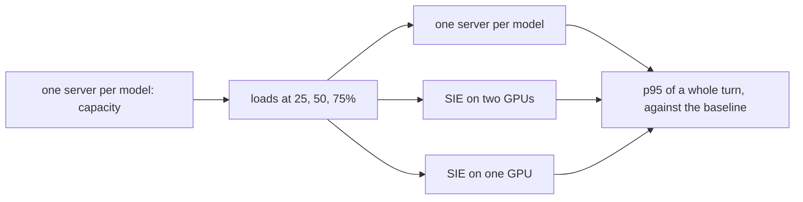

# Pack an agent's five models onto fewer GPUs, and measure what a turn costs

> **This example:** one agent turn is five calls in a row (a guard model, an embedder, a reranker, a
> classifier and a PII detector). The recipe serves the five models three ways: one SIE server per
> model on its own GPU, SIE on two GPUs, and SIE on one GPU, and sends each the same turns.
>
> **How it works:** it finds how many turns a second the one-per-model setup can take, then sends turns
> at random intervals at 25%, 50% and 75% of that to every setup, and compares the p95 of a whole turn.
>
> **Use the same pattern for:** deciding how many GPUs your own agent's models need before you buy them.
> Put your models and your turn in `rules.yaml` and run it on your traffic levels.

## Background

An agent rarely calls one model. A typical support agent checks the user's message with a guard
model, embeds it, reranks the passages it found, classifies the request, and checks its reply for
personal details before sending it. Each of those models uses a fraction of a GPU, and the standard
setup (one vLLM, TEI or SGLang server per model) gives each one a whole GPU anyway. That's five cards
for maybe one card's worth of work.

## The problem

Packing the models onto fewer GPUs saves money, but the user waits for the whole turn, five calls in
a row, and every call that waits for a shared GPU adds to it. The question is how much it adds at the
traffic you actually have. Packing by hand means a server with several models in it, memory sized for
all of them, and a way to batch requests per model; SIE does that part. Whether the latency holds is
something you measure.

### Examples

The 40 user messages in `data/messages.json` are synthetic, written for this recipe. The passages are
the first 500 documents of NFCorpus (BeIR/nfcorpus, CC BY-SA 4.0, revision `b5026a0e`), in
`data/passages.json`; `fetch_data.py` rebuilds them. Each turn reranks 20 passages and checks one
passage for personal details as a stand-in for the reply.

1. **One SIE server per model, each on its own GPU.** The baseline: five GPUs, nothing shared.
2. **SIE on two GPUs:** the guard model alone on one, the four small encoders sharing the other. At
   50% load, the p95 of a whole turn should stay within 1.25 times the baseline's.
3. **SIE on one GPU:** all five models on one card. The same bar.

## How we'll solve it

The recipe starts the servers for a setup, sends 30 seconds of untimed turns, then sends turns as a
Poisson process (random arrivals at a fixed average rate) for 2 minutes at each load, and counts what
finishes after the first 20 seconds. The loads are shares of the baseline's capacity, found first by
keeping 32 turns in flight for a minute.

With four GPUs instead of five, the baseline runs in two passes: the guard, embedder, reranker and
classifier on four GPUs, then the PII model alone. Each baseline turn is a four-model turn plus a PII
call drawn at random from the second pass at the same load. In a real five-GPU setup the PII server
shares nothing with the other four, so its latency doesn't depend on theirs, which is what the random
pairing assumes. The capacity is the lower of the two passes.

## Picking the models

- **`Qwen/Qwen3Guard-Gen-0.6B`** checks the message (chat, 8 output tokens). It's the only generative
  model of the five, served through SGLang.
- **`BAAI/bge-m3`** embeds the message.
- **`BAAI/bge-reranker-v2-m3`** scores 20 passages against it. It's the heaviest call in the turn.
- **`MoritzLaurer/deberta-v3-base-zeroshot-v2.0`** classifies the message into one of five labels.
- **`urchade/gliner_multi_pii-v1`** finds names, emails, phone numbers, addresses and organizations in
  the reply.

## The flow



## How it's built

All of it is Python and `rules.yaml`: the models, the turn's order, which models share a server, the
loads and the bar.

| Step | Function | What it does |
| --- | --- | --- |
| Start a setup | `Runner.start`, `Launcher.start` | One `sie_server.cli serve` per GPU, with its models preloaded |
| One turn | `one_turn`, `make_calls` | The five calls in order through the SIE SDK, stopping at the first failure |
| Capacity | `Runner.capacity`, `closed_loop` | 32 turns in flight for a minute on the baseline |
| Loads | `poisson` | Turns at random intervals at each rate |
| Baseline on four GPUs | `Runner.passes`, `compose_baseline` | Two passes and the random pairing |
| Summary | `cell`, `table`, `verdicts` | p50, p95, failures, per-call p95, GPUs and cost |

## Run it

**Run this recipe using [SIE Serverless](https://superlinked.com/serverless?utm_source=github&utm_medium=docs&utm_campaign=sie-cookbook&utm_content=why-sie-pack-five-models-on-one-gpu), [SIE Cluster](https://superlinked.com/docs/deployment?utm_source=github&utm_medium=docs&utm_campaign=sie-cookbook&utm_content=why-sie-pack-five-models-on-one-gpu) or [SIE Local](https://superlinked.com/docs/quickstart?utm_source=github&utm_medium=docs&utm_campaign=sie-cookbook&utm_content=why-sie-pack-five-models-on-one-gpu).** This one is an exception: it compares GPU layouts, so it needs SIE Local on a machine with several GPUs you control. For SIE Serverless, get an [SIE API key](https://console.superlinked.com/console/keys?utm_source=github&utm_medium=docs&utm_campaign=sie-cookbook&utm_content=why-sie-pack-five-models-on-one-gpu) and read the [API docs](https://superlinked.com/docs/reference/api?utm_source=github&utm_medium=docs&utm_campaign=sie-cookbook&utm_content=why-sie-pack-five-models-on-one-gpu). To run the models yourself, start from the [SIE repo](https://github.com/superlinked/sie).

You need [uv](https://docs.astral.sh/uv/), Docker with the NVIDIA container toolkit, and four or five
24 GB GPUs (we used four A10s) with nothing else on them. Run it on that machine:

```bash
uv run recipe.py --gpus 4                       # all three setups, about 45 minutes
uv run recipe.py --gpus 4 --setups two_gpus     # one setup (the baseline always runs first)
uv run selfcheck.py                             # optional: offline checks, no GPU
```

With Docker, each server runs from the published SIE image its models need: `cuda12-sglang` for the
guard and `cuda12-default` for the other four. The one-GPU setup puts the guard and the encoders in
one server, which no published image serves (each serves one bundle of models), so with Docker it's
skipped. Run it with `--launcher process` in an environment built from SIE's source, with
`--models-dir` pointing at SIE's model configs; that's how we ran all three setups for this README.
Each run writes `runs/<timestamp>/summary.json`, `turns.jsonl` (every turn with its five calls) and
the server logs; `--output DIR` changes that.

## What came out

We ran it on 16 Nov 2026 at 03:41 UTC on four NVIDIA A10 GPUs (24 GB each), with `--launcher process`
in an environment built from SIE v0.11.1's source. The baseline's capacity was 9.6 turns a second, so
the loads were 2.4, 4.8 and 7.2 turns a second. One run, 2 minutes a load, the first 20 seconds of
each not counted. Monthly cost is the number of GPUs at $584 each (an L4 at $0.80 an hour).

| Setup | GPUs | Monthly | Load | p50 turn | p95 turn | p95 vs one per model | Failed turns |
| --- | --- | --- | --- | --- | --- | --- | --- |
| One server per model | 5 | $2,920 | 25% | 226 ms | 330 ms | 1.00 | 0 of 221 |
| | | | 50% | 239 ms | 482 ms | 1.00 | 0 of 486 |
| | | | 75% | 364 ms | 1.09 s | 1.00 | 0 of 720 |
| SIE, two GPUs | 2 | $1,168 | 25% | 239 ms | 470 ms | 1.43 | 0 of 221 |
| | | | 50% | 439 ms | 1.01 s | 2.10 | 0 of 486 |
| | | | 75% | 1.09 s | 7.59 s | 6.98 | 0 of 720 |
| SIE, one GPU | 1 | $584 | 25% | 260 ms | 580 ms | 1.76 | 0 of 221 |
| | | | 50% | 579 ms | 1.53 s | 3.17 | 0 of 486 |
| | | | 75% | 5.17 s | 56.1 s | 51.6 | 0 of 720 |

p95 of each call at 50% load:

| Call | One per model | Two GPUs | One GPU |
| --- | --- | --- | --- |
| Guard | 63 ms | 66 ms | 140 ms |
| Embed | 16 ms | 146 ms | 189 ms |
| Rerank | 366 ms | 391 ms | 840 ms |
| Classify | 20 ms | 155 ms | 187 ms |
| PII | 55 ms | 338 ms | 432 ms |

### The three examples

**1. One server per model.**
- **Expected outcome:** the baseline; every turn answered.
- **What came back:** p95 turn of 330 ms, 482 ms and 1.09 s at the three loads, no failed turns. The
  reranker is the slowest call by far (366 ms at p95 at 50% load).
- **Verdict:** Pass.

**2. SIE on two GPUs.**
- **Expected outcome:** p95 turn at 50% load within 1.25 times the baseline.
- **What came back:** 2.10 times (1.01 s against 482 ms). The guard, alone on its GPU, kept its
  latency; the three small encoders sharing a card with the reranker waited behind its batches (the
  embedder's p95 went from 16 ms to 146 ms).
- **Verdict:** Miss.

**3. SIE on one GPU.**
- **Expected outcome:** the same bar.
- **What came back:** 3.17 times at 50% load. At 75% the reranker fell far behind and the p95 turn
  took 56 seconds, though no turn failed within the 120-second timeout.
- **Verdict:** Miss.

### Results

1 of 3 setups came out as expected.

**Where it works:** light traffic. At 25% load, two GPUs kept the p95 turn under half a second for
40% of the GPU bill, and the p50 barely moved (239 ms against 226 ms).

**Where it fails:** medium and heavy traffic, and the reason is one model. The reranker is the slowest
call, and the small models that share its GPU wait behind its batches, so their latency goes up even
though their own work is tiny. This matches our earlier, longer runs of the same comparison (three
runs, 5 minutes a load), where two GPUs came out at 1.76 times the baseline at 50% load and one GPU at
2.51 times; this shorter run came out worse on both, and neither passes.

### What you do next

Find your heaviest model before you pack. If one model in the turn is much slower than the rest,
packing the small models with it costs them latency; give it a GPU of its own and pack the rest (we
didn't test that layout here). Then run this recipe with your models at your traffic, and pick the
smallest layout whose p95 you can live with.

## Potential improvements

- A layout with the reranker on its own GPU and the other three encoders sharing a second one.
- Three runs and 5 minutes a load, to narrow the spread.

## Try another model

The five models are in `rules.yaml`, with the server layout for each setup. Any model SIE serves can
replace one of them, as long as the call in `make_calls` matches its task (chat, encode, score or
extract). We haven't run other models in this recipe yet. See [MODELS.md](../../MODELS.md) for every
model these recipes use.

## Run it using SIE Cluster or SIE Local

This recipe already runs the SIE servers itself, on the machine with the GPUs. The table gives the SIE
image each model runs on, from SIE's
[compatibility matrix](https://github.com/superlinked/sie/blob/main/docs/compatibility.md).

| `rules.yaml` key | Model | Image | Tested on |
| --- | --- | --- | --- |
| `guard` | `Qwen/Qwen3Guard-Gen-0.6B` | `cuda12-sglang` | L4 |
| `embed` | `BAAI/bge-m3` | `cuda12-default` | L4 |
| `rerank` | `BAAI/bge-reranker-v2-m3` | `cuda12-default` | L4 |
| `classify` | `MoritzLaurer/deberta-v3-base-zeroshot-v2.0` | `cuda12-default` | L4 |
| `pii` | `urchade/gliner_multi_pii-v1` | `cuda12-default` | L4 |

```bash
docker run --gpus all -p 8080:8080 -v sie-hf-cache:/app/.cache/huggingface \
  ghcr.io/superlinked/sie-server:v0.11.1-cuda12-default
```

## Files

- `recipe.py`: starts the servers, sends the turns and writes the summary
- `selfcheck.py`: plain asserts on the passes, the baseline pairing, the percentiles and the verdicts,
  no GPU (`uv run selfcheck.py`)
- `rules.yaml`: models and images, the turn's order, the server layouts, the loads and the bar
- `fetch_data.py`, `data/passages.json`, `data/messages.json`: the inputs
- `pyproject.toml`, `uv.lock`: this recipe's dependencies
