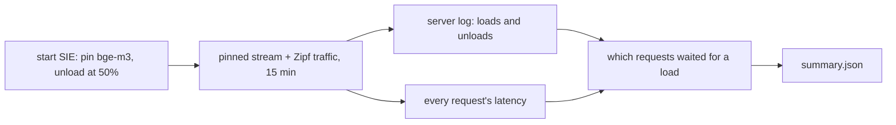

# Serve more small models than fit on one GPU, and see what packing costs

> **This example:** one SIE server on one 24 GB GPU, told to start unloading at half the card. First
> ten small models that fit under that line, then sixteen that don't, with one model pinned and
> traffic that keeps shifting from model to model.
>
> **How it works:** the recipe sends a steady stream to the pinned model and random requests to the
> others, split by a Zipf popularity that rotates every 150 seconds. It reads every load and unload
> from the server's log and works out which requests had to wait for their model.
>
> **Use the same pattern for:** deciding whether your models fit on the GPUs you have, and which one to
> pin, before your users find out for you.

## Background

A team that has moved its small models off a paid API ends up with a lot of them: a few embedders, a
reranker or two, PII and entity extractors, a zero-shot classifier. Each one is small, and together
they'd waste most of a GPU each if every one got its own. So they share one, and the server decides
which ones stay loaded.

Built by hand, that decision is yours. You run one server per model and accept the idle GPUs, or you
write the loading and unloading yourself: track memory, pick what to evict, keep the model on your
critical path from being evicted. SIE does it in the server. Models load on their first request, the
least recently used one is unloaded when GPU memory passes a threshold (95% by default), and models
you pin are never unloaded.

## The problem

Packing works while your working set fits. When it doesn't, the server swaps, and every swap costs
the request that triggered it a model load. A number on a slide won't tell you where that line is for
your models. Running your traffic against them will.

### Examples

The passages are the first 500 documents of NFCorpus (BeIR/nfcorpus, CC BY-SA 4.0, revision
`b5026a0e`), in `data/passages.json`; `fetch_data.py` rebuilds them. `recipe.py` cuts each one to
its first 1,000 characters when it reads them.

1. **Ten models that fit.** `BAAI/bge-m3` (pinned) and nine more small encoders, rerankers and
   extractors. Nothing should be unloaded once they're all loaded.
2. **Sixteen models that don't.** The same ten plus six more. SIE should unload models to make room,
   and requests that find their model unloaded should wait for it to load.
3. **The pinned model, in both.** `BAAI/bge-m3` should never have to load again.

## How we'll solve it

SIE's threshold can't go below 50%, so the recipe sets `SIE_MEMORY_PRESSURE_THRESHOLD_PERCENT=50`: on
a 24 GB card, SIE starts unloading at about 11.5 GB, as on a card half the size. That way a handful of
small models is enough to overflow it, and you don't need a 7B model to see swapping.

Traffic, for 15 minutes per setup:

- **Pinned:** 4 requests a second to bge-m3, steady.
- **Everything else:** 6 requests a second in total, at random intervals, split by Zipf popularity
  (s = 1.1), so the top model gets about a third of them and the bottom ones a few percent. Every 150
  seconds the ranking shifts by one model, so the popular models keep changing.

A request counts as "waited for a load" when the server's log shows a load of its model finishing
while the request was in flight, give or take a second: the recipe matches the "loaded successfully"
line, and the log only stamps whole seconds. It's an approximation, and a close one: a request that
waits for a load takes seconds, and one that doesn't takes milliseconds.

## Picking the models

All sixteen are small open models that SIE v0.11.1 serves from its `cuda12-default` image, so one
server runs them all. bge-m3 is pinned because it's the kind of model that sits on a search path,
where a cold start is a user waiting. The rest are a realistic mix: embedders (e5, mxbai, arctic,
multilingual e5), rerankers (bge-reranker-v2-m3 and -large), GLiNER entity and PII extractors, and
DeBERTa zero-shot classifiers. The six in the second setup are on adapters the first ten already use,
so the only thing that changes is how much memory the set needs.

## The flow



## How it's built

All of it is Python and `rules.yaml`.

| Step | Function | What it does |
| --- | --- | --- |
| Start SIE | `start_server`, `wait_healthy`, `warm_pinned` | `docker run` of the SIE image (or the same server as a process), pinned model preloaded |
| Traffic | `drive`, `zipf_weights`, `ranking_at`, `call` | The pinned stream and the rotating Zipf traffic, one record per request |
| GPU memory | `GpuSampler` | Peak memory from `nvidia-smi`, once a second |
| Loads and unloads | `log_events` | Every "loaded successfully" and "Unloading model" line in the server log |
| Summary | `summarize`, `verdicts` | Unloads an hour, waits for a load, other latency, the pinned model, against what each example expects |

The model lists, the label set each extractor uses, rates, rotation, threshold, timeout and the
share of failed requests the "fit" setup allows (`max_failed_share`) are in `rules.yaml`. The
pinned verdict fails if any request to the pinned model fails. Both of a setup's verdicts fail when
the setup crashes or its server stops early (the reason says "not measured"), and when the recipe
finds no load of the pinned model in the server log, which means the log format changed. The recipe
writes `summary.json` after each setup and exits non-zero when any verdict fails.

## Run it

**Run this recipe using [SIE Serverless](https://superlinked.com/serverless?utm_source=github&utm_medium=docs&utm_campaign=sie-cookbook&utm_content=why-sie-serve-more-models-than-fit), [SIE Cluster](https://superlinked.com/docs/deployment?utm_source=github&utm_medium=docs&utm_campaign=sie-cookbook&utm_content=why-sie-serve-more-models-than-fit) or [SIE Local](https://superlinked.com/docs/quickstart?utm_source=github&utm_medium=docs&utm_campaign=sie-cookbook&utm_content=why-sie-serve-more-models-than-fit).** This one needs SIE Local on a GPU you control, because it sets the server's unload threshold and reads its log; SIE Serverless manages both for you. For SIE Serverless, get an [SIE API key](https://console.superlinked.com/console/keys?utm_source=github&utm_medium=docs&utm_campaign=sie-cookbook&utm_content=why-sie-serve-more-models-than-fit) and read the [API docs](https://superlinked.com/docs/reference/api?utm_source=github&utm_medium=docs&utm_campaign=sie-cookbook&utm_content=why-sie-serve-more-models-than-fit). To run the models yourself, start from the [SIE repo](https://github.com/superlinked/sie).

You need [uv](https://docs.astral.sh/uv/), Docker with the NVIDIA container toolkit, and one 24 GB
GPU (we used an A10; an L4 has the same memory) with nothing else on it. Run it on that machine:

```bash
docker pull ghcr.io/superlinked/sie-server:v0.11.1-cuda12-default
uv run recipe.py                       # both setups, 15 minutes each, plus model downloads
uv run recipe.py --setups overflow --minutes 5
uv run selfcheck.py                    # optional: offline checks, no GPU
```

`--launcher process` runs the same server without Docker. It needs the Python interpreter of an
environment with SIE installed, passed as `--server-python`, for example
`uv run recipe.py --launcher process --server-python /path/to/sie/.venv/bin/python`; this recipe's
own environment doesn't have the server. The recipe checks that the port in `rules.yaml` is free
before it starts the server. Each run writes `runs/<timestamp>/summary.json`, one `requests-<setup>.jsonl`
per setup and the server logs; `--output DIR` changes that. The sixteen models download into
`~/.cache/huggingface` on the first run.

## What came out

We ran it on 16 Nov 2026 from 03:41 UTC on one NVIDIA A10 (24 GB), with `--launcher process` in an
environment built from SIE v0.11.1's source, which is what the `cuda12-default` image is built from.
We didn't run the Docker launcher for this README.

### The three examples

**1. Ten models that fit.**
- **Expected outcome:** no unloads once the models are loaded.
- **What came back:** 10 loads, 0 unloads in 15 minutes; peak GPU memory 11.1 GB of 23 GB, just under
  the unload point. 9,028 requests, none failed. The 90 requests that arrived while their model was
  loading for the first time waited a median of 11.2 s (27.0 s at p95); everything else answered in a
  median of 17 ms (43 ms at p95).
- **Verdict:** Pass.

**2. Sixteen models that don't fit.**
- **Expected outcome:** SIE unloads to make room, and requests whose model was unloaded wait for it.
- **What came back:** 450 loads and 443 unloads in 15 minutes, about 1,740 unloads an hour, one every
  two seconds. 1,977 of 9,028 requests (22%) waited for a load: a median of 10.5 s, 22.0 s at p95. The
  rest slowed down too, to a median of 314 ms (1.75 s at p95), because the card was busy loading.
  72 requests failed (0.8%): 71 with `Model '...' is unloading`, sent to a model at the moment SIE was
  unloading it, and one `internal error during extraction`.
- **Verdict:** Pass.

**3. The pinned model, in both.**
- **Expected outcome:** bge-m3 never loads again.
- **What came back:** 0 cold starts in 3,360 requests in each setup, and none failed. With the models
  fitting, its p99 was 34 ms. With sixteen, the median went from 16 ms to 281 ms and the p99 to 2.1 s:
  it stayed loaded, but it shared a GPU that was loading something every two seconds.
- **Verdict:** Pass.

### Results

3 of 3 examples came out as expected.

These match what we measured in November with two GPUs behind SIE's gateway and queue: no unloads
when ten models fit; with sixteen, about 1,290 unloads an hour per GPU, a median wait for a load of
8.7 s (27 s at p95), and a pinned model with zero cold starts whose p99 went from 41 ms to 5.1 s.

**Where it works:** a working set that fits. Ten models shared one card with nothing unloaded, at
millisecond latency, and pinning kept bge-m3 loaded through both setups.

**Where it fails:** a working set that doesn't fit. Packing turns into swapping: a fifth of the
requests waited about ten seconds for their model, everything else got nearly twenty times slower, and almost
1% failed because their model was being unloaded as they arrived. Pinning keeps a model loaded; it
doesn't keep it fast.

### What you do next

Add up what your models need at their peak, not their weights, and compare it with the card. Run this
recipe with your own model list and traffic. If the "overflow" numbers look like yours, either cut the
set, give the busiest models their own GPU, or pin only what a user waits on and accept that the rest
will sometimes take ten seconds.

## Potential improvements

- Run two servers behind SIE's gateway and queue, as in our cluster test: there, 45% of loads were for
  a model the other worker already had, because any worker in a pool can load any model. One server
  can't show that.
- Plan the placement first. SIE v0.11.1 added a placement planner
  ([`sie_placement`](https://github.com/superlinked/sie/tree/main/packages/sie_placement)) that works out
  which models go on which GPUs, and how many to keep warm, from measurements of each model alone and
  beside its neighbours, GPU prices and hourly demand. We haven't run it in this recipe.
- Retry requests that fail with "is unloading", since they'd succeed a few seconds later.

## Try another model

The model lists are in `rules.yaml`. Any model SIE's `cuda12-default` image serves can go in either
list, and any one of them can be the pinned model. We haven't run another set yet.

## Run it using SIE Cluster or SIE Local

This recipe already runs the SIE server itself, on the machine with the GPU. Every model runs on the
same image, from SIE's
[compatibility matrix](https://github.com/superlinked/sie/blob/main/docs/compatibility.md).

| `rules.yaml` key | Models | Image | Tested on |
| --- | --- | --- | --- |
| `pinned` | `BAAI/bge-m3` | `cuda12-default` | A10 |
| `fit` | the nine listed there | `cuda12-default` | A10 |
| `overflow` | the six listed there | `cuda12-default` | A10 |

```bash
docker run --gpus all -p 8080:8080 -v sie-hf-cache:/app/.cache/huggingface \
  -e SIE_PINNED_MODELS=BAAI/bge-m3 -e SIE_MEMORY_PRESSURE_THRESHOLD_PERCENT=50 \
  ghcr.io/superlinked/sie-server:v0.11.1-cuda12-default
```

## Files

- `recipe.py`: starts the server, sends the traffic, reads the log and writes the summary
- `selfcheck.py`: plain asserts on the shape of the model lists, the Zipf split, the log parser,
  the summary and the verdicts, no GPU (`uv run selfcheck.py`)
- `rules.yaml`: image, threshold, pinned model, traffic, the two model lists
- `fetch_data.py`, `data/passages.json`: the inputs
- `pyproject.toml`, `uv.lock`: this recipe's dependencies
