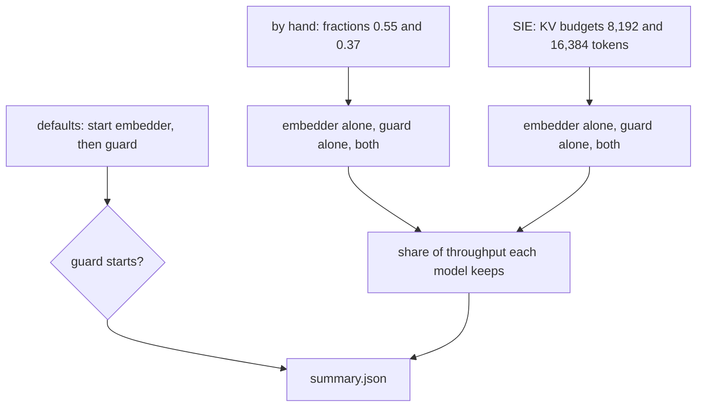

# Put two SGLang models on one GPU, by hand and with SIE

> **This example:** a 4B embedding model and a 0.6B guard model, both served best by SGLang, on one
> 24 GB L4, set up three ways: plain SGLang at its defaults, plain SGLang with memory set by hand, and
> one SIE server.
>
> **How it works:** the recipe starts the servers from the SIE image (which has SGLang 0.5.10.post1 in
> it), runs each model alone and then both at once with the same requests in flight, and reports what
> share of its throughput alone each model keeps.
>
> **Use the same pattern for:** any pair of models you'd like on one card. Change the two models in
> `rules.yaml` and run it before you buy the second GPU.

## Background

An agent rarely calls one model. A typical one embeds text for search and checks every message with a
guard model, and neither model needs a whole GPU: a 4B embedder and a 0.6B guard fit on a 24 GB L4
with room to spare. Putting them on one card halves the GPU bill, and it's the first thing a team
tries once the second model goes into production.

## The problem

SGLang assumes it owns the GPU. At its defaults on an L4 it claims about 82% of the card's memory as
soon as it starts, so a second SGLang server on the same card runs out of memory before it serves a
request. You can set `--mem-fraction-static` by hand for each one, but a fraction says nothing about
what the model needs: you work out the weights and the KV cache you want, turn both into a share of
this particular card, start the server, and read its log to see whether you got it. Change the card
or the model, and you do it again.

Built by hand, that's the job. SIE does the arithmetic from the model's files instead: it reads the
weight sizes and the layer counts, adds the KV cache for a number of tokens you state, and passes
SGLang exactly that fraction.

### Examples

The passages are the first 500 documents of NFCorpus (BeIR/nfcorpus, CC BY-SA 4.0, revision
`b5026a0e`), in `data/passages.json`; `fetch_data.py` rebuilds them. The 30 chat messages in
`data/prompts.json` are synthetic, written for this recipe.

1. **Plain SGLang at its defaults.** Start the embedder, then the guard next to it. The guard should
   fail to start.
2. **Plain SGLang with memory set by hand** (`--mem-fraction-static` 0.55 for the embedder, 0.37 for
   the guard, the values we found for this pair on an L4). Both should start, and with both busy each
   should keep at least 80% of its throughput alone.
3. **One SIE server**, told the embedder needs 8,192 tokens of KV cache and the guard 16,384. Both
   should start on the first try, and each should keep at least 80%.

## How we'll solve it

For setups 2 and 3, the recipe runs the embedder alone for 2 minutes, the guard alone for 2 minutes,
then both for 4 minutes, with 8 requests in flight per model the whole time, and counts what
finishes after the first 30 seconds of each phase. The embedder's throughput is input tokens a second;
the guard's is checks a second (each answer is capped at 32 tokens).

The 80% bar is what we hoped sharing would cost, written down before we first ran this. It's a
throughput bar, and memory alone can't meet it: once both models fit, they still share one GPU's
compute.

## Picking the models

- **`Qwen/Qwen3-Embedding-4B`**: a strong open embedder that SIE serves through SGLang. At its
  defaults SGLang gives it a KV cache of about 75,000 tokens, far more than an embedder that sees
  passages under 8,000 tokens needs.
- **`Qwen/Qwen3Guard-Gen-0.6B`**: a small generative guard model, also on SGLang. It needs little
  memory, which makes it the obvious second tenant for the card.

## The flow



## How it's built

All of it is Python and `rules.yaml`. The model configs in `models/` are SIE v0.11.1's own, copied
unchanged; the recipe writes a copy with the KV budgets from `rules.yaml` into the run folder.

| Step | Function | What it does |
| --- | --- | --- |
| Start a server | `Launcher.start`, `sglang_args`, `sie_args` | `docker run` of the SIE image (or the same command as a process) |
| Wait for it | `wait_healthy` | Polls `/health` (SGLang) or `/healthz` (SIE); fails if the server exits |
| Defaults | `run_defaults` | Starts the embedder, then the guard, and checks the guard's log for out-of-memory |
| By hand, SIE | `run_by_hand`, `run_sie`, `measure_pair` | Each model alone, then both, through `drive` |
| Load | `drive`, `sglang_calls`, `sie_calls` | 8 requests in flight per model; SGLang's OpenAI API or the SIE SDK |
| Summary | `kept`, `verdicts` | Throughput together divided by alone, against `keep_at_least` |

## Run it

**Run this recipe using [SIE Serverless](https://superlinked.com/serverless?utm_source=github&utm_medium=docs&utm_campaign=sie-cookbook&utm_content=why-sie-share-one-gpu-between-two-sglang-models), [SIE Cluster](https://superlinked.com/docs/deployment?utm_source=github&utm_medium=docs&utm_campaign=sie-cookbook&utm_content=why-sie-share-one-gpu-between-two-sglang-models) or [SIE Local](https://superlinked.com/docs/quickstart?utm_source=github&utm_medium=docs&utm_campaign=sie-cookbook&utm_content=why-sie-share-one-gpu-between-two-sglang-models).** This one is the exception: it compares setups on one GPU, so it needs SIE Local on a machine you control, and SIE Serverless decides GPU placement for you. For SIE Serverless, get an [SIE API key](https://console.superlinked.com/console/keys?utm_source=github&utm_medium=docs&utm_campaign=sie-cookbook&utm_content=why-sie-share-one-gpu-between-two-sglang-models) and read the [API docs](https://superlinked.com/docs/reference/api?utm_source=github&utm_medium=docs&utm_campaign=sie-cookbook&utm_content=why-sie-share-one-gpu-between-two-sglang-models). To run the models yourself, start from the [SIE repo](https://github.com/superlinked/sie).

You need [uv](https://docs.astral.sh/uv/), Docker with the NVIDIA container toolkit, and one 24 GB
GPU (we used an L4) with nothing else on it. Run it on that machine:

```bash
docker pull ghcr.io/superlinked/sie-server:v0.11.1-cuda12-sglang
uv run recipe.py                       # all three setups, about 40 minutes
uv run recipe.py --setups sie          # one setup
uv run selfcheck.py                    # optional: offline checks, no GPU
```

`--launcher process` starts the same commands without Docker, for a machine that already has the
image's Python environment (SGLang and `sie-server` on the path). Each run writes
`runs/<timestamp>/summary.json`, the server logs and the model configs it used; `--output DIR`
changes that. Model weights download into `~/.cache/huggingface` on the first run.

## What came out

We ran it on 16 Nov 2026 at 01:22 UTC on one NVIDIA L4, with `--launcher process` inside a container
built from SIE v0.11.1's SGLang image source (the same code and SGLang version as the published
image). In the published `v0.11.1-cuda12-sglang` image itself, the two
plain-SGLang setups run, but SIE refuses the embedder, because that image only serves the `sglang`
bundle and SGLang embedders are in `sglang-embedding`, which has no published image yet
([superlinked/sie#969](https://github.com/superlinked/sie/issues/969)). Until that's fixed, run the
SIE setup with `--launcher process` in an environment built from SIE's source.

### The three examples

**1. Plain SGLang at its defaults.**
- **Expected outcome:** the guard fails to start next to the embedder.
- **What came back:** the embedder started with a KV cache of 75,464 tokens and 2.48 GB of the card
  left. The guard died while loading: `torch.OutOfMemoryError: CUDA out of memory. Tried to allocate
  14.00 MiB. GPU 0 has a total capacity of 22.06 GiB of which 70.62 MiB is free.`
- **Verdict:** Pass.

**2. Plain SGLang with memory set by hand.**
- **Expected outcome:** both start, and each keeps at least 80%.
- **What came back:** both started. Alone, the embedder did 5,884 tokens a second and the guard 62.7
  checks a second. Together, 3,761 and 29.7: the embedder kept 64% and the guard 47%. No request
  failed.
- **Verdict:** Miss.

**3. One SIE server.**
- **Expected outcome:** both start on the first try, and each keeps at least 80%.
- **What came back:** both started on the first try. SIE logged 12.06 GiB for the embedder and 6.27
  GiB for the guard (fractions 0.460 and 0.372) and passed them to SGLang. Alone, 5,815 tokens a
  second and 44.0 checks a second; together, 3,846 and 28.3: the embedder kept 66% and the guard 64%.
  No request failed.
- **Verdict:** Miss.

### Results

1 of 3 setups came out as expected.

**Where it works:** getting two SGLang models onto one card. At the defaults it can't be done; by
hand it took us two tries to find fractions that gave each model the cache it needed; SIE worked
them out from the model files and both started on the first try. Shared, the card did more work than
either model alone: the two shares add up to 1.11 by hand and 1.30 with SIE, though the SIE figure
is flattered by the guard's slower alone number (below).

**Where it fails:** the 80% bar. Memory was solved, and the two models were then splitting one GPU's
compute, so neither setup came close. And read the guard's numbers with care: alone, it answered 44
checks a second through SIE against 63 on plain SGLang, so part of its better share under SIE comes
from a slower start. Together, the two setups did about the same work: 28 vs 30 checks a second, and
3,846 vs 3,761 tokens a second. SIE saves you the memory arithmetic, not compute.

### What you do next

Set each model's KV budget from your own traffic: the longest input it really sees, times the
requests you want in flight. That number decides whether two models fit on a card. Then run this
recipe with your pair, and decide from the "together" numbers whether one card is enough for your
load, or whether the busier model needs a GPU of its own.

## Potential improvements

- Run each setup three times and report the median; one run is what this README shows.
- Look into the guard's lower throughput alone through SIE, which is a fair question for SIE to answer.

## Try another model

The two models are in `rules.yaml`, with their revisions. Another pair needs its SIE configs in
`models/` (copy them from the [SIE repo](https://github.com/superlinked/sie/tree/v0.11.1/packages/sie_server/models)),
new KV budgets and, for the by-hand setup, fractions you work out yourself, which is the point. We
haven't run another pair yet.

## Run it using SIE Cluster or SIE Local

This recipe already runs the SIE server itself, on the machine with the GPU. The table gives the SIE
image each model runs on, from SIE's
[compatibility matrix](https://github.com/superlinked/sie/blob/main/docs/compatibility.md).

| `rules.yaml` key | Model | Image | Tested on |
| --- | --- | --- | --- |
| `embedder` | `Qwen/Qwen3-Embedding-4B` | `cuda12-sglang` (how we ran it; the matrix lists this model under the `sglang-embedding` bundle, which has no published v0.11.1 image) | L4 |
| `guard` | `Qwen/Qwen3Guard-Gen-0.6B` | `cuda12-sglang` | L4 |

```bash
docker run --gpus all -p 8080:8080 -v sie-hf-cache:/app/.cache/huggingface \
  ghcr.io/superlinked/sie-server:v0.11.1-cuda12-sglang
```

## Files

- `recipe.py`: starts the servers, drives the load and writes the summary
- `selfcheck.py`: plain asserts on the server commands, the model configs and the verdicts, no GPU
  (`uv run selfcheck.py`)
- `rules.yaml`: image, models and revisions, fractions, KV budgets, load and the bar
- `models/`: SIE v0.11.1's configs for the two models, unchanged
- `fetch_data.py`, `data/passages.json`, `data/prompts.json`: the inputs
- `pyproject.toml`, `uv.lock`: this recipe's dependencies
